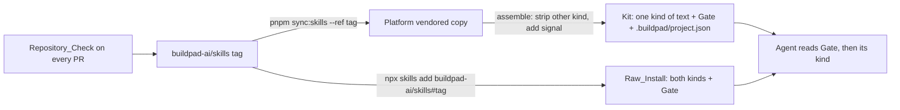
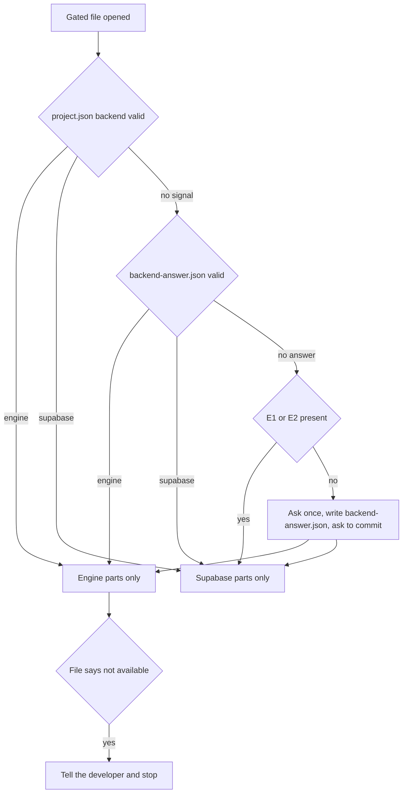
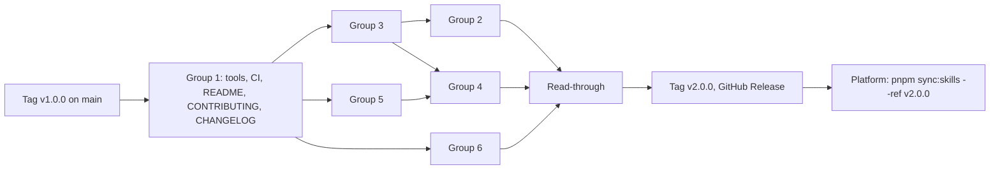

# Design Document: Backend-Aware Skills (skills repository part)

> **Approved 16 October 2026** (with all three repositories' designs; see `spec.json`, `design_approval_note`). The status note below records how the document was written.
> **Engine-fact corrections, 17 October 2026.** Ten Engine facts that tasks 4 to 8 found while converting differ from this design or extend it. They are recorded in [Engine-fact corrections, 17 October 2026](#engine-fact-corrections-17-october-2026); the rest of the document is unchanged.
> **Status.** Not approved. Phase 2 of a gated spec, written against the **approved** requirements
> of this folder (7 requirements, 68 criteria, 66 live, 2 withdrawn; SD-1 and SD-2 settled; Skill
> map amended 16 October 2026 with the maintainer's approval). Revised 16 October 2026 to close
> every item of its review (M1 to M5, S1 to S14 and the suggestions taken) and to follow the
> Skill-map corrections.
>
> **Revisions read (read, not run).** This repository at **`origin/main` = `7ed910f`** (fetched
> 16 October 2026; read with `git show` / `git archive` only). The working tree is on branch
> `docs/ide-neutral-instruction-paths` at `ad57772`; the one difference that matters is
> `add-workflows/SKILL.md` (commit `873f492`, 3 lines), which only `origin/main` holds. Everything
> below, including the line numbers cited, is `origin/main`. Binding contracts: the Platform design
> `buildpad-platform/.kiro/specs/engine-backed-project-provisioning/design.md` as revised on 16
> October 2026, cited by its content: sha256 `01d4421a7d36bf56999584d446fb9a3720310a07df54fc48749eab5f1dc1b085`. That file is untracked in
> `buildpad-platform`, so no commit names it; any other content is a Revalidation Trigger (§C11,
> §C12, §C13 with its shared contract, §C20, KitAssembler, BackendPassageStripper, KitGuard,
> SkillsSync, Testing Strategy). Engine facts: `buildpad-daas-go` `main` at `d893e3cd` (the same
> revision the requirements read): `src/domain/auth/routes/auth_routes.go`,
> `src/domain/mcp/feature/tools/*.go`, `docs/AUTOMATION_RUNTIME.md`. Skills CLI behaviour: the
> cached `skills@1.7.1` (`dist/cli.mjs`). The per-skill plan reuses the two-reader classification
> of 13 October 2026; every claim this design relies on for a contract was re-checked (list in
> [Supporting References](#supporting-references)).
>
> **Contract rule.** §C11, §C12, §C13 and §C20 are cited, never redefined. Where one of them cannot
> be met as written in this repository, it is listed under [Issues found](#issues-found) with a
> proposed change, and this design complies with the text as it stands.

## Overview

**Purpose.** One set of skills serves two kinds of project. Every file that holds text true for one
backend only marks that text in place with the §C13 markers; every such file carries one fixed
procedure (the **Gate**) that tells the agent how to establish the backend before it reads any
marked text. A Kit assembled by the Platform has the other backend's text removed and carries the
Backend_Signal; a Raw_Install (`npx skills add`) carries both backends' text and the Gate. The
Supabase view of every changed file stays the baseline text, except where a change is listed and
released with a reason.

**Users.** Agents in Engine_Projects and Supabase_Projects (through a Kit or a Raw_Install);
developers who pin a release of the skills; the maintainers of this repository, who get named
revisions and a Repository_Check that refuses a change breaking these rules.

**Impact.** 44 of 64 folders change (21 in-file passages, 3 separate Engine file sets, 2
unavailable-and-stop, 2 not-yet-available-and-stop, 16 reworded); 20 stay byte-identical. New:
`tools/repo-check/` (check script, contract data, test cases, per-folder conversion files),
`.github/workflows/repo-check.yml`,
`CHANGELOG.md`, `CONTRIBUTING.md`, tags `v1.0.0` (baseline) and `v2.0.0` (first release).

### Goals
- Every live criterion realised in this repository, traced in
  [Requirements Traceability](#requirements-traceability).
- The Gate, the Recorded_Answer, the Supabase evidence and the Engine statements worded once and
  reused verbatim.
- The Supabase view of every file provably equal to `v1.0.0` apart from listed, released changes.
- A Repository_Check whose marker grammar and guard patterns are the Platform's, byte for byte.

### Non-Goals
- Stripping passages, writing the Backend_Signal, layouts, the sync (the Platform's, §C13, KitAssembler, SkillsSync).
- Platform-authored guidance, the consumer CLI templates (PP-36), the SDK (PP-21), the Engine, the Studio.
- Moving a Supabase_Project to the Engine; running an agent against a skill (SD-2).
- Engine steps for capabilities that wait on an unmet dependency (Requirement 4 criterion 7): they
  are written in the release that follows the dependency being met (Revalidation Triggers).

## Boundary Commitments

### This Spec Owns
- The text and files of all 62 Skills, the personas in `agents/`, the checklists in `references/`
  and the Specification_Templates under `buildpad-spec-init`, `buildpad-steering` and
  `buildpad-steering-custom` (`settings-templates/`), including every marker in them (Decision AB).
- The Gate text, its placement rules, the Recorded_Answer file name and format, and the Supabase
  evidence (SD-1, left to design).
- The Engine statement set (ES-1 to ES-16) and the two unavailable-and-stop texts.
- Tags, release notes (`CHANGELOG.md`), the README, `CONTRIBUTING.md`.
- The Repository_Check (`tools/repo-check/`), its contract data file and its CI workflow.
- `tools/repo-check/skill-map.json`, the machine copy of the Skill_Map.

### Out of Boundary
- `.buildpad/project.json` (the Platform writes it, §C12); this repository only reads it.
- Removing passages from a Kit, every IDE layout, the worker starter, `skills-vendor.json`
  (the Platform's Requirement 7 criteria 19 to 22, 27, 28).
- The always-loaded instruction file, kit README, project templates, env file, MCP configuration
  (the Platform's Requirement 7 criterion 10).
- What the CLI generates (PP-36), what the SDK sends (PP-21, PP-34), Engine behaviour (PP-29,
  PP-30, PP-35, EP-*).
- `buildpad-copilot` and same-name engineering skills in other repositories.

### Allowed Dependencies
- The Platform design's §C11 (names), §C12 (signal file and reading rule), §C13 (grammar, issue
  codes, link and front-matter rules), §C20 (guard patterns and the fenced-block rule).
- Routes and MCP tools served by `buildpad-daas-go` `d893e3cd` and the runtime contract of
  `docs/AUTOMATION_RUNTIME.md`, as named in ES-1 to ES-16 and the per-skill plan.
- The skills CLI's `owner/repo#ref` and `owner/repo#ref@skill` sources (`cli.mjs` 163-181, 305-315).
- Repository_Check: Node.js 22 LTS standard library only (Node 24 also works; Node 20 left support
  in April 2026): `node:fs`, `node:path`, `node:child_process` for `git show` and `git ls-tree`,
  `node:test`; no npm dependency, so no `package.json` and nothing to install.
- Direction: skill text depends on contracts; the check depends on the contract data file and the
  baseline tag; nothing in a skill depends on the check.

### Revalidation Triggers
Each forces a re-read of the files this design names and, where text changes, a release:
- **§C12** (path, field, values, reading rule), **§C13** (regex, kinds, issue codes, file and
  directory rules, front-matter rule, `references/` rule, link rule, recorded breaks), **§C20**
  (any pattern id or regex, the path rule, the fenced-block rule). The contract data file must be
  updated in the same change, and the cases re-run (Testing Strategy).
- **The shared contract** (S8): `tools/repo-check/contract/backend-contract.json` and `cases.json`
  are vendored by the Platform and its tests run against them, so a change to either is a change in
  both repositories, released in a tag and synced before the Platform's tests can pass.
- **The Platform design's content** (its sha256 in the header): a revision re-reads §C11 to §C13
  and §C20.
- **§C11** (`NEXT_PUBLIC_BUILDPAD_TENANT_ID`, `buildpad-engine-public-anon-key`): ES-3.
- **The Platform's MCP project shape** (`projectBackend`, `engineUrl`, `daasUrl`,
  `projectTenantId`, `tenantVariable`, `publicAnonKey`): add-microapp, worker-messaging.
- **Engine routes a skill names** (ES-1 to ES-16, per-skill rows), **MCP tools served**
  (`items`, `schema`, `collections`, `fields`, `relations`, `files`, `folders`, `users`, `roles`,
  `permissions`, `policies`, `access`, `scope`, `system-prompt` and the `daas_*` verbs), and the
  **runtime** (`docs/AUTOMATION_RUNTIME.md` §2, §3, §4, §6, §7).
- **A dependency becoming met**: PP-29 (cron, services, extensions tools), PP-30 (Worker_Token
  on the data API), Decision P's scheduler running (3.14), PP-35 (several holders of one session:
  the microfrontend skills), PP-21/PP-34/PP-36 (generated modules usable), PP-16 (worker
  permission over collections not yet created). Each changes a not-yet-available statement into
  steps (Requirement 4 criterion 7). PP-28 (`X-Tenant-Id` allowed cross-origin) changes ES-4 and
  ES-11: a browser may then name the tenant itself.
- **A new Skill** (5.8): a row in `skill-map.json` and the requirements' Skill map.

## Contracts used and names fixed here

### Cited, not redefined
| § | What this repository uses | Where |
|---|---|---|
| §C11 | `NEXT_PUBLIC_BUILDPAD_TENANT_ID`; anon value `buildpad-engine-public-anon-key` | ES-3, ES-4 |
| §C12 | `.buildpad/project.json`, field `backend`, values `"engine"`/`"supabase"`, invalid = no signal; the Recorded_Answer in a different file | Gate step 1, S1 |
| §C13 | The marker regex, the three marker forms, `engine-only`/`supabase-only`, every `MarkerIssue` code, no marker in front matter, no subfolder in top-level `references/`, links resolving in both stripped views, the seven recorded breaks, links inside fenced code blocks are not links, plain words for unavailable features, and the shared contract the Platform vendors (S8) | S4, Repository_Check R2, R5, R6, R9, R12 |
| §C20 | The 13 pattern ids and regexes, the path rule, the fenced-block rule (`credentials: 'include'` with a data-API address) | Repository_Check R1 |

Notation: §C20's table writes `\|` for the regex alternation inside a Markdown table; the regex
itself is `|`. The contract data file holds the unescaped JavaScript source (S8).

### S1 Recorded_Answer (SD-1)
- **File:** `.buildpad/backend-answer.json` at the project root (the name §C12 suggests).
- **Content** written by the agent: exactly
  `{"buildpadBackendAnswer": 1, "backend": "engine"}` or the same with `"supabase"`; UTF-8, LF,
  a trailing newline. `buildpadBackendAnswer` is the format version.
- **Reading rule:** as §C12's: parse as JSON, read `backend`; a missing file, text that is not
  JSON, or another value is no answer.
- **Version control:** the Gate tells the agent not to add it to `.gitignore` and to ask the
  developer to commit it (1.12). The Platform's planned test `backend-signal-gitignore.test.ts`
  (its Testing Strategy) will prove that no Kit ignores it.
- The agent never writes `.buildpad/project.json` (§C12).

### S2 Positive evidence of a Supabase_Project (SD-1, 1.11)
Either of, checked by listing files only, with no file content read:
| Id | Evidence | Why it is positive |
|---|---|---|
| E1 | A folder `supabase` at the project root holds a folder `migrations` with at least one file ending `.sql` | Only `create-migration` writes there; an Engine Kit cannot hold such a path (§C20 path rule), and `create-migration` stops on an Engine_Project |
| E2 | A folder `supabase` at the project root holds `config.toml` | Written by the Supabase CLI, which an Engine_Project never uses |

Declined as evidence (Design choices 2): any `SUPABASE_*` name, `lib/supabase/*`, `@supabase/*`
dependencies (an Engine_Project keeps the Supabase client for sign-in); the env file and MCP
configuration (they hold secrets, 1.7, and are git-ignored); `get_project_detail` (returns
`mainGitToken`); the Kit's always-loaded file (Platform-authored text this repository cannot pin).
The Gate states E1 and E2 in plain words, because `supabase/migrations/` is a §C20 pattern and the
Gate is kept in Engine Kits.

### S3 The Gate (Requirement 1, criteria 1, 5, 7, 10, 11, 12)
The canonical text is the file `tools/repo-check/gate.md`, and every copy is byte-identical to it
(line endings aside). It is Markdown; the two sentinel lines are HTML comments that do not contain
the §C13 token, so they are not markers and survive stripping in both Kits (Platform Ordering:
"the skills' gate text is kept").

```markdown
<!-- backend-gate:begin v1 -->
**Establish the backend first.** A Buildpad project's backend is either the Buildpad Engine or
Supabase, and some parts of this file hold for one of them only. Before you act on anything in
this file, find the backend with these steps, in order, and stop at the first step that answers:

1. Read `.buildpad/project.json` at the project root. If it is JSON and its field `backend` is
   `"engine"` or `"supabase"`, that is the backend. If `.buildpad/backend-answer.json` names the
   other backend, tell the developer the two files disagree, and follow `.buildpad/project.json`.
2. Otherwise read `.buildpad/backend-answer.json` in the same way; if its `backend` is
   `"engine"` or `"supabase"`, that is the backend.
3. If a folder named `supabase` at the project root holds a file named `config.toml`, or holds a
   folder named `migrations` that holds a file whose name ends in `.sql`, the backend is Supabase.
4. Otherwise ask the developer once: "Is this project's backend the Buildpad Engine or
   Supabase?" Write the answer to `.buildpad/backend-answer.json` as
   `{"buildpadBackendAnswer": 1, "backend": "engine"}` or
   `{"buildpadBackendAnswer": 1, "backend": "supabase"}`, and ask the developer to commit that
   file. Do not add it to `.gitignore`. Never write `.buildpad/project.json`.

To find the backend, do not open an environment file (`.env`, `.env.*`) or an MCP configuration
file, and do not call a tool that returns project credentials.

Then follow only the parts for that backend. A part starts at a line that holds only a comment
whose text is `buildpad` + `-backend: engine` or `buildpad` + `-backend: supabase`, and ends at the
next line that holds only a comment whose text is `/buildpad` + `-backend`. A comment that merely
mentions a backend is not a part. A file whose first line, after any front matter, holds only a
comment whose text is `buildpad` + `-backend-file: engine` (or `supabase`) holds for that backend
only, and so does every file in a folder named `engine-only` or `supabase-only`. Skip the other
backend's parts and copy no code from them; everything else holds for both. On an Engine project, when this file says that
something is not available, tell the developer so and stop: do not build a substitute.
<!-- backend-gate:end -->
```

| Property | How the text meets it |
|---|---|
| Three states (SD-1) | Engine only on step 1 or 2 (1.10); Supabase only on steps 1, 2 or 3 (1.11); otherwise step 4 asks once and records (1.5, 1.12). The signal wins a disagreement, and the developer is told (step 1) |
| No secret (1.7) | Reads two committed JSON files and lists two paths; forbids env files, MCP configuration and credential-returning tools (`get_project_detail`) |
| Kept in Engine Kits | Matches no §C20 pattern; holds no §C13 token: each marker text is written as two code spans joined by `+`, so the token never appears whole (§C13 `malformed-marker`) |
| Only real markers are parts | A part is a line holding only the marker comment (the §C13 grammar); a sentence or comment that names a backend is not one |
| In a stripped Kit | The marker lines are gone, so the "parts" sentence describes nothing; step 1 answers from the signal |
| Unavailable features (4.8) | The last sentence, once for every gated file |

### S4 Placement (1.2, 1.3, 1.6)
| File kind | What it carries | Where |
|---|---|---|
| `SKILL.md` of a Skill in which any file holds a passage, a file marker or an `*-only` folder | The Gate | First content after front matter, or directly after the first `# ` heading when that heading is the first content; only blank lines may precede it otherwise |
| Any other Markdown file holding an opener | The Gate | Same rule; before its first opener |
| Markdown file with a file marker (`buildpad-backend-file: <kind>`) | File marker, then the Gate | Marker on the first non-blank line after front matter (§C13); the Gate on the next non-blank line |
| `.ts`/`.tsx` asset holding an opener or a file marker | The Pointer line (S5) | First line, or the line after the file marker |
| File in an `engine-only`/`supabase-only` folder that takes no comment (JSON) | Nothing | Allowed only if every link to it comes from the same Skill, from text of the same kind |
| Persona, reference checklist, Specification_Template holding an opener | The Gate | Same rule (Decision AB; 7.9) |
| `buildpad-steering`, `buildpad-steering-custom` `SKILL.md` (no passage) | The Gate | Same rule; they record the backend into steering (5.6, row 33/43) |

Consequences: a single-skill install holds the Gate in every gated file it carries (1.6); a deep
link from another Skill lands in a file that carries its own Gate (1.3), and no link from another
Skill may target an asset (rule R3; none does at `7ed910f`).

### S5 The Pointer line (assets)
For a code asset that is copied into an application, the full Gate would be copied into the
application's source. Assets carry one line instead, in the file's comment syntax:

```ts
// Backend: before using this file, establish the backend as "Establish the backend first" in this skill's SKILL.md says, keep only the parts for that backend, and copy no marker line into the application.
```

Assets are reached only from their own Skill's files (R3), whose `SKILL.md` carries the Gate, so
1.2 and 1.6 hold; 1.3 cannot arise.

### S6 Marker forms used here (from §C13, not redefined)
| Use | Form |
|---|---|
| Markdown passage | `<!-- buildpad-backend: engine -->` … `<!-- /buildpad-backend -->` (or `supabase`) |
| TypeScript passage | `// buildpad-backend: supabase` … `// /buildpad-backend` |
| Whole Markdown file | `<!-- buildpad-backend-file: engine -->` on the first non-blank line after front matter |
| Whole TypeScript file | `// buildpad-backend-file: supabase` on line 1 |
| Whole folder | not used for Markdown here; reserved for comment-less assets (none needs it at `7ed910f`) |

Authoring rules this repository adds (checked by R2): a passage closes before a Markdown heading
of a higher level than the one it opened under; a fenced code block is wholly inside or wholly
outside a passage, and so is a Markdown table: a planned range that starts or ends inside a fence or
a table widens to the whole fence or table, and no marker line stands inside either
(`straddles-fence`, `marker-in-table`); an `engine` and a `supabase` passage that replace each other
are adjacent, the `supabase` one first, with no blank line between the closer of the first and the
opener of the second (`gap-between-passages`), so a reader of the raw file sees the baseline text
first and the stripped views keep the baseline's blank lines. An Engine passage that points into
another Skill links that Skill's `SKILL.md`, never one of its reference files, so no change waits
for another Skill's new Engine file (File Structure Plan).

### S7 Unavailable-and-stop texts (Requirement 4 criteria 1, 3, 4)
**S7-A `add-external-oauth`**, the Engine passage directly after the Gate, before any step; the
`supabase` passage is the rest of the body, lines 9 to 683:

```markdown
<!-- buildpad-backend: engine -->
## On an Engine project: not available

External OAuth sign-in is not available on an Engine project. The Engine signs users in with an
email and a password only: it has no OAuth or one-time-code exchange, no route that turns an outside
identity into a session, and no administration API for accounts. Write no file for this request.
Tell the developer that OAuth sign-in is not available on an Engine project and stop. The Platform's
password-less handoff is for opening the Studio and is not a way for an application to sign a user
in. Users of an Engine project are created by an administrator: see the `add-users` skill.
<!-- /buildpad-backend -->
```

**S7-B `create-migration`**, the Engine passage directly after the Gate, before any step (4.4); the
`supabase` passage is the rest of the body, lines 9 to 101:

```markdown
<!-- buildpad-backend: engine -->
## On an Engine project: there are no migrations

An Engine project has no database migrations, and nothing reads a migration file there. Write no
file. Tell the developer that structure and access are changed through the Engine, and stop here:
- a table, a column, a relation or an index: the `create-collection` skill;
- who may read or change it: the `create-rbac` skill, and `relational-permissions` for nested writes;
- a workflow column: the `create-workflow` skill; multi-level data separation: `manage-scope`.
<!-- /buildpad-backend -->
```

Both say what is unavailable in plain words (§C13 last rule): neither names an identifier the
guard matches. The rest of each `SKILL.md` and every reference of the two Skills becomes `supabase`
text (rows 1 and 3 of the marking plan).

### S8 Contract data file (keeps §C13 and §C20 identical in both repositories)
`tools/repo-check/contract/backend-contract.json` is the machine copy of the Platform design's §C13
and §C20, transcribed verbatim. This repository owns the file; the Platform vendors it, with
`cases.json`, at every sync, and its tests run against both (its §C13, "Shared contract"):

```json
{
  "contract": "buildpad-backend-passages",
  "version": 1,
  "source": "buildpad-platform .kiro/specs/engine-backed-project-provisioning/design.md §C13 §C20",
  "markerRegex": "^[ \\t]*(?:<!--|//|#|--|/\\*)?[ \\t]*(/buildpad-backend|buildpad-backend(-file)?:[ \\t]*([A-Za-z]+))[ \\t]*(?:-->|\\*/)?[ \\t]*$",
  "token": "buildpad-backend",
  "kinds": ["engine", "supabase"],
  "onlyDirs": {"engine-only": "engine", "supabase-only": "supabase"},
  "steeringToken": "kiro-steering:",
  "issueCodes": ["malformed-marker", "unpaired-open", "unpaired-close", "nested", "unknown-kind",
    "straddles-steering", "misplaced-file-marker", "conflicting-scope", "marker-in-front-matter"],
  "guardPatterns": [
    {"id": "rpc", "regex": "\\.rpc\\("},
    {"id": "rest", "regex": "/rest/v1/"},
    {"id": "service-role", "regex": "SUPABASE_SERVICE_ROLE_KEY|service_role|serviceRoleKey"},
    {"id": "auth-admin", "regex": "auth\\.admin\\."},
    {"id": "client-auth", "regex": "auth\\.(updateUser|exchangeCodeForSession|verifyOtp|signInWithOtp|resetPasswordForEmail)\\("},
    {"id": "stored-supabase", "regex": "createClient\\(\\s*process\\.env\\.SUPABASE"},
    {"id": "sql-policy", "regex": "CREATE POLICY|auth\\.uid\\(\\)|storage\\.objects|auth\\.users"},
    {"id": "migration", "regex": "supabase/migrations/|supabase (db push|migration new)"},
    {"id": "storage", "regex": "storage\\.(from|createBucket|updateBucket)\\("},
    {"id": "service-token-data", "regex": "DAAS_SERVICE_TOKEN|Bearer \\$\\{?SERVICE_TOKEN"},
    {"id": "cors-mcp", "regex": "mcp_daas_cors-settings|\"name\":\\s*\"cors-settings\""},
    {"id": "missing-mcp", "regex": "mcp_daas_(smtp-settings|module_access_keys)\\b|\"name\":\\s*\"(smtp-settings|module_access_keys)\""},
    {"id": "platform-supabase", "regex": "supabaseServiceRoleKey|supabaseAnonKey|supabaseUrl"}
  ],
  "guardPathRegex": "(^|/)supabase/migrations/",
  "guardPathSuffixUnderSkill": ".sql",
  "fencedBlockRule": {"credentials": "credentials:\\s*['\"]include['\"]", "dataApi": "DAAS_URL|/items"},
  "fencedLinksAreLinks": false,
  "recordedLinkBreaks": [
    {"file": "create-rbac/SKILL.md", "lineAtBaseline": 288, "target": "../../references/module-access-checklist.md", "layouts": ["repository", "kiro", "claude", "antigravity"]},
    {"file": "grant-module-access/SKILL.md", "lineAtBaseline": 245, "target": "../../references/module-access-checklist.md", "layouts": ["repository", "kiro", "claude", "antigravity"]},
    {"file": "relational-permissions/SKILL.md", "lineAtBaseline": 242, "target": "../../microbuild-supabase-users/docs/RELATIONAL_PERMISSIONS.md", "layouts": "all"},
    {"file": "generate-docs/references/documentation.instructions.md", "lineAtBaseline": 190, "target": "./related1.md", "layouts": "all"},
    {"file": "generate-docs/references/documentation.instructions.md", "lineAtBaseline": 191, "target": "./related2.md", "layouts": "all"},
    {"file": "generate-docs/references/documentation.instructions.md", "lineAtBaseline": 320, "target": "./related1.md", "layouts": "all"},
    {"file": "generate-docs/references/documentation.instructions.md", "lineAtBaseline": 321, "target": "./related2.md", "layouts": "all"}
  ]
}
```

Patterns are case-sensitive JavaScript regexes, applied per line, as §C20 states. A recorded break
is matched by `file` and `target` (`lineAtBaseline` locates it at `v1.0.0`, since edits move lines)
in the views named by `layouts` ("repository" is this repository's own tree); an entry whose link no
longer exists matches nothing and fails nothing. `fencedLinksAreLinks: false` is §C13's rule that a
link inside a fenced code block (CommonMark: a fence closes only on a run of the same character at
least as long) is not a link. How the two repositories stay identical:
1. This repository's `contract.test.mjs` asserts the file's values against a second, literal copy
   of §C13's regex and §C20's table inside the test, and fails on any difference; a change to
   either is a Revalidation Trigger and needs both edits in one pull request.
2. `tools/repo-check/contract/cases.json` holds shared cases (input text, expected `MarkerIssue`
   codes with lines; input line, expected pattern ids; link texts, expected links). This
   repository's check runs them.
3. **Adopted by the Platform (its §C13, Shared contract, revised 16 October 2026; Issue 4):** its
   sync vendors both files into `src/templates/skills-contract/`, recorded in `skills-vendor.json`,
   and its `backend-passages.test.ts`, `kit-guard.test.ts`, `kit-links.test.ts` and
   `skills-contract.test.ts` assert that its grammar, `ENGINE_KIT_FORBIDDEN_PATTERNS`, path rule,
   fenced-block rule and recorded breaks equal the vendored file, and run `cases.json`. Neither
   repository can then change the contract without the other's tests failing until both agree.

### S9 Tags and releases (Requirement 6)
| Name | What | When |
|---|---|---|
| `v1.0.0` | Annotated tag on the Baseline_Revision. Message: `Baseline_Revision: the last revision of main before backend-aware-skills` | First task, before any change of this feature merges: on `origin/main` as it stands then (`7ed910f` if nothing else merges first); if `main` has moved, on the first parent of the first merge that carries this feature |
| `v2.0.0` | First release carrying this feature | After every row of the marking plan has merged and the read-through (Testing Strategy) passed |
| `vMAJOR.MINOR.PATCH` after that | MAJOR: the Supabase view of any file changes (an entry in `supabase-view-changes/*.json`), a Skill is removed or renamed, or the Gate's version changes. MINOR: a Skill is added, or Engine-only text changes. PATCH: neither (typos, Engine text corrected without new steps) | Every release; tags are never moved |

- **Record of what changed (6.2, 2.4):** `CHANGELOG.md` at the root, one section per tag, with a
  subsection "Supabase projects" that lists every entry of `supabase-view-changes/*.json` released
  in that tag, with its reason; the GitHub Release of the tag carries the same section.
- **Installing a tag (6.3):** the CLI parses `#<ref>` and `#<ref>@<skill>` (`cli.mjs` 163-181,
  305-315) and clones at that ref; tags are immutable, so `npx skills add buildpad-ai/skills#v2.0.0`
  delivers the tree of `v2.0.0`. The tree URL form `https://github.com/buildpad-ai/skills/tree/v2.0.0/create-project`
  also works. The lock records the ref, so `npx skills update` stays on it.
- **The Platform** vendors a tag with `pnpm sync:skills --ref v2.0.0`, recorded in
  `src/templates/skills-vendor.json` (SP-2, PP-39: the Platform's work).

## Engine statement set (Requirements 3 and 4)

Fixed texts, worded once here and copied verbatim into the `engine` passages that need them (the
per-skill plan names which). ES-4 and ES-11 follow the Platform's PP-28 and the infrastructure's
Decision 7, option (a): until an Engine release allows `X-Tenant-Id` from another origin, a
browser's preflight drops a request that carries it, so the tenant is named by the server-side
sign-in; when PP-28 is met they change in the next release (Revalidation Triggers). A Skill may add specifics around them, never contradict them. None
holds a §C20 pattern or the §C13 token, so each may also stand in shared text when it opens with
"On an Engine project" (the form the reworded folders use, Requirement 5 criterion 2).

| Id | Criteria | Text |
|---|---|---|
| ES-1 | 3.3 | On an Engine project the data API's address is the Engine_URL, which both `NEXT_PUBLIC_BUILDPAD_DAAS_URL` and `NEXT_PUBLIC_SUPABASE_URL` hold. The Studio's address is an administration interface: send no data call to it. |
| ES-2 | 3.1, 3.2 | On an Engine project every data call carries the signed-in user's access token as `Authorization: Bearer <access token>`, from the application's own server route or from the SDK. The Engine accepts no cookie session on its data API. The token in the project's MCP configuration is accepted only on the MCP endpoint `/api/mcp`: never send it, or any other administrator token, to the data API. |
| ES-3 | 3.4 | On an Engine project the environment is: `NEXT_PUBLIC_SUPABASE_URL=<Engine_URL>`, `NEXT_PUBLIC_BUILDPAD_DAAS_URL=<Engine_URL>`, `NEXT_PUBLIC_SUPABASE_ANON_KEY=buildpad-engine-public-anon-key` (a fixed value that is not a secret; the Engine does not read it, the Supabase client needs one), and `NEXT_PUBLIC_BUILDPAD_TENANT_ID=<the project's tenant id>`. There is no service-role key on an Engine project: add none. |
| ES-4 | 3.8 | On an Engine project the data API serves no request without a session; only the sign-in, `GET /api/server/info` and the Engine's password routes (which ES-5 says not to use) are served without one. The requests that take their tenant from the header `X-Tenant-Id` are the password sign-in and anonymous reads of public files. A browser cannot send `X-Tenant-Id` to the Engine until the Engine allows that header from another origin, which it does not yet do: so the request that names the tenant is the sign-in made through the application's own server route, which sends `X-Tenant-Id` with the value of `NEXT_PUBLIC_BUILDPAD_TENANT_ID`. A public file shown in a browser is loaded through a signed URL from `/api/files/signed-url`, not by an anonymous read. A request without a session that names no tenant is served from the Engine's host plane, not from the project. A request with a session takes its tenant from the session. |
| ES-5 | 3.5, 3.16, 4.2, 4.5 | On an Engine project the Supabase client is kept for sign-in only. Password sign-in, session refresh, reading the signed-in user and sign-out work through it, and its default sign-out ends the user's sessions on every device. An account that holds no role in the project's tenant is refused at sign-in. Not available on an Engine project: sign-up; OAuth sign-in; magic link and one-time code; password recovery; changing a password, an email or a profile through the Supabase client; code exchange; and the Supabase administration API. The Platform's password-less handoff opens the Studio; it is not a way for an application to sign a user in. |
| ES-6 | 4.6 | On an Engine project multi-factor enrolment, challenge and verification are not served through the Supabase client. The Engine's own routes, each called with the user's session, are `POST /api/auth/mfa/enroll`, `GET /api/auth/mfa/factors`, `POST /api/auth/mfa/verify` and `POST /api/auth/mfa/unenroll`; a session that still needs its second factor is accepted elsewhere only after `POST /api/auth/mfa/verify`. |
| ES-7 | 3.7, 3.17 | On an Engine project an administrator creates every user, through the Engine's user API (`POST /api/users` with an administrator's session) or the Studio's Users module, and gives the user a role in the project's tenant (`POST /api/users/:id/roles` with `role_id`, or the Users module). An administrator resets a user's password, in the Studio's Users module. |
| ES-8 | 3.6 | On an Engine project collections, fields, relations, roles, policies and permissions are created through the Engine's API (`/api/collections`, `/api/fields/:collection`, `/api/relations`, `/api/roles`, `/api/policies`, `/api/access`, `/api/permissions`) or its MCP tools `collections`, `fields`, `relations`, `roles`, `policies`, `access` and `permissions`. Access is roles, policies and permissions: a permission belongs to a policy, and a policy is attached to a role or a user. The MCP `collections` and `fields` tools keep a field's name, type and `meta` but not its `schema` block (default, not-null, length): set those through `POST /api/fields/:collection` with an administrator's session. |
| ES-9 | 3.9 | On an Engine project the project is one tenant. Every scope hierarchy begins below the project's tenant node: create no scope type without a parent and no scope item without a parent. Scope types, items and collection settings are managed through `/api/scope/types`, `/api/scope/items` and `/api/scope/collection-config` with an administrator's session; the MCP `scope` tool only assigns a role to a user at a scope (`assign_user_role`). |
| ES-10 | 3.10 | On an Engine project stored code (hooks, cron jobs, custom services) runs in the Engine's runtime, which provides only what the table [Engine runtime](#engine-runtime-es-10) lists; for each interface it lacks, the table says what replaces it. |
| ES-11 | 3.11 | On an Engine project files are stored and served by the Engine: `/api/files`, `/api/folders`, `/api/files/signed-url`, and file content at `/api/files/assets/:id` (with a session or a signed token). A file shown in a browser, a public one included, is loaded through a signed URL from `/api/files/signed-url`: a browser cannot name the tenant on an anonymous read yet (ES-4). Set no storage bucket option: the Engine stores files on its own disk or in S3. |
| ES-12 | 3.12 | On an Engine project tests create their users and roles as ES-7 says, sign in as ES-5 says, and use the environment of ES-3. The only secrets a pipeline needs are the test administrator's email and password; it needs no Supabase secret. |
| ES-13n | 3.14, 4.7 | (while Decision P's scheduler is unmet) On an Engine project the scheduler does not run yet: a cron job runs only when it is run by hand (`POST /api/cron/:id/run`). Scheduled runs are not available on an Engine project yet. |
| ES-13m | 3.14 | (replaces ES-13n in the release after the Dependencies list the scheduler as available) On an Engine project an active cron job fires at its scheduled time. |
| ES-14n | 5.7, 5.9, 4.7 | (while PP-30 is unmet) On an Engine project a worker reaches the data API at `DAAS_URL`, the Engine_URL, and presents its own worker token, read from `DAAS_TOKEN`, as `Authorization: Bearer`; never the project's MCP token. The worker may create, read, update and delete the items of every collection a member creates, and may change no collection, field, relation, role, policy, permission, account or setting. Until the Engine accepts the worker token on its data API, a worker cannot reach the data API of an Engine project: tell the developer so and stop. |
| ES-14m | 5.7, 5.9 | (after PP-30, and PP-16 for collections created later) ES-14n without its last sentence. |
| ES-15 | 3.1 | On an Engine project the data API accepts requests from any origin and never with cookies, as the project is provisioned. Change no cross-origin setting, and do not add the application's origin anywhere. |
| ES-16 | 3.1, 4.7 | On an Engine project some files the Buildpad CLI generates cannot be used yet: `lib/supabase/admin.ts`, the OAuth callback and provider routes, the server-side enforcer and session modules, and `lib/module-access/enforce.ts`. Do not call them; check module access by forwarding the user's token to `GET <Engine_URL>/api/permissions/me` and reading `isAdmin` and `moduleAccess`. |

### Engine runtime (ES-10)
Source: `buildpad-daas-go/docs/AUTOMATION_RUNTIME.md` at `d893e3cd` (sections in brackets).

| Interface taught on a Supabase_Project | On the Engine | Replacement |
|---|---|---|
| The Supabase service in stored code (`services.supabase`) | Refused permanently, 501 `RUNTIME_SUPABASE_UNAVAILABLE` (§2.4) | `services.items(collection)`, with `{ elevated: true }` where the job must act as an administrator |
| SQL functions and raw SQL from stored code | No path (§2) | `services.items` calls, or a custom service |
| `services.items(c)` methods | Nine: `readByQuery`, `readOne`, `readMany`, `createOne`, `createMany`, `updateOne`, `updateMany`, `deleteOne`, `deleteMany`; `readByQuery` returns the array itself (§2) | Read `result`, not `result.data` |
| Query keys | `fields`, `filter`, `sort`, `limit`, `page`, `offset`, `search`; any other key is refused | Drop the key |
| Schema services | Read only: `readAll`, `readOne` | Change structure through ES-8 |
| `services.files` | Metadata only: `readByQuery`, `readOne` | Bytes through the application and `/api/files` |
| `services.mail` | Options `to`, `subject`, `html`, `text`, `replyTo`; returns `{ success, ... }`, does not throw (§6) | Check `success` |
| `services.env` | Empty unless the operator names keys (`RUNTIME_ENV_WHITELIST_<SCOPE>`, `RUNTIME_ENV_WHITELIST_GLOBAL`) (§7) | Ask the operator to name the key; never assume one |
| `services.fetch` | Only hosts in `EXTENSION_ALLOWED_DOMAINS`; empty list allows loopback only | Ask the operator to allow the host |
| `fetch`, `process`, `require`, `import`, `setTimeout`, `setInterval`, `eval`, `Function` | Do not exist (§1) | `services.fetch`; no timers |
| `Intl`, as in `create-service` lines 97-101 | Not found in the runtime's globals (`context`, `services`, `console`, `JSON`, `Date`, `Math`) | Format numbers by hand |
| `console` in a custom service body | Not in scope (§3); in hooks, cron jobs and service tests it is | Return what should be recorded |
| `console.table`, `console.trace` | Do not exist; `log`, `info`, `debug`, `warn`, `error` only (§4) | `console.log` |
| Update and delete hook payloads | `meta.keys` (array); `meta.key` only on create (§5) | Use `meta.keys` |
| Throwing from a filter hook | `new HookError(message, status, code)` is in scope | Unchanged |
| Filesystem extensions, `/api/ext/*` endpoints | None | Stored hooks, cron jobs, custom services |

## Marking plan (Requirement 5)

Derived from the Skill_Map at the end of the requirements as amended 16 October 2026 (the rows
`worker-messaging`, `grant-module-access` and `references`, and the microfrontend Skills not yet
available on the Engine), refined by criterion 5.3 where noted (rows 27 and 28, Issue 9).
Codes: **BP** in-file passages; **EF** separate Engine file set; **US** unavailable and stop
(S7); **NY** not yet available and stop (4.7); **RW** reworded, no passage (5.2); **RW+G**
reworded and the Gate added, no passage; **UC** unchanged, byte-identical (2.2). "Gate" means
the S3 block placed by S4; "sup" and "eng" mean `supabase` and `engine` passages; "file:sup"
means a whole-file `supabase` marker plus the Gate. Line numbers are `7ed910f`. A listed range
that starts or ends inside a fenced code block or a Markdown table covers the whole block or table
(S6). Size is person-days in this repository, by the method under the table.

| # | Folder | Code | Files and what is marked | Engine content | Size |
|---|---|---|---|---|---|
| 1 | add-external-oauth | US | `SKILL.md`: Gate after H1; S7-A; sup = the rest of the body (9-683). `references/oauth-implementation.instructions.md`: file:sup. Description reworded (R11) | S7-A | 0.5 |
| 2 | create-api-route | EF | `SKILL.md`: Gate; sup = body 9-115 verbatim; eng = new body (forwarder template, links to the Engine file). `references/api-routes.instructions.md`, `references/api-authorization.instructions.md`: file:sup. New `references/engine-api-routes.instructions.md`: file marker `engine` + Gate | 5.4: every data route forwards `Authorization` to `<Engine_URL>/api/...` via `getAuthHeaders()`/`getDaasUrl()` (`@/lib/api/auth-headers`), passes the Engine's status and `{errors:[...]}` through; sections: items list/one (with `X-Resource-Uri` passthrough), workflow transition (`POST /api/workflow/transition`), users me (`GET`/`PATCH /api/users/me`), files and signed URL (ES-11), permissions (`GET /api/permissions/me`), versions (`/api/versions`, save, promote), local utilities; ES-1, ES-2, ES-4, ES-5, ES-16; no table, remote-procedure or service-role guidance | 1.75 |
| 3 | create-migration | US | `SKILL.md`: Gate after H1; S7-B; sup = rest (9-101). `references/special-fields.instructions.md`: file:sup | S7-B | 0.5 |
| 4 | add-buildpad | BP | `SKILL.md` 29-38, 45, 85, 113. `references/buildpad.instructions.md` 89-109, 138, 157-166, 399-416, 534-635, 665-710, 923-964, 1044-1069, 1169-1199 | ES-1, ES-2 (DaaSProvider/Storybook take a session token, not a static token), ES-11 (asset path), ES-16; deletes answer 204 with no body; `limit=-1` refused | 1.25 |
| 5 | add-cron | BP | `SKILL.md` 32-41 (address, CORS), 171, 194 (the `mfaRequired` error kind: an eng passage after it), 203, 213 | ES-1, ES-15, ES-13n, ES-6 (a session that still needs its second factor); pointer to `create-cron`'s Engine runtime | 0.25 |
| 6 | add-files | BP | `SKILL.md` 26-28, 47, 53-67, 136-166 | ES-1, ES-11, ES-15; upload limit `APP_MAX_UPLOAD_BYTES` (100 MiB), no MIME allow list; delete answers 204; generated assets proxy targets a path the Engine does not serve (Issue 6) | 0.25 |
| 7 | add-i18n | BP | `SKILL.md` 39-42, 57, 69-70, 119, 125-131. `references/content-translations.instructions.md` 11-13, 21-142 (SQL mirror 121-142 sup), 150-310 (SQL mirror 288-310 sup), 316-334, 397-468. `references/locale-routing.instructions.md` 9, 93-160 | ES-8 (create through `POST /api/collections` with inline fields or `POST /api/schema/apply` for a multi-column unique), ES-9 (scope below the tenant), no SQL mirror; language through `PATCH /api/users/me` | 1.75 |
| 8 | add-microapp | BP | `SKILL.md` 13-26 (links into `add-microfrontend/references/auth-bridge…` move into sup), 72-86 (Step 0), 138-149, 151-213, 350-394, 585-596, 626. `references/context-discovery.instructions.md` 32-48, 120-130, 153-158. `references/app-urls-config.instructions.md` 8-16, 115 (link, sup), 118-140. `references/deployment-topology.instructions.md` 5-63, 140-156, 203, 246. `references/cross-service-communication.instructions.md` 7, 40, 73-92, 123-146. `references/service-boundaries.instructions.md` 82, 171 | Step 0 reads `project.projectBackend`, `engineUrl`, `daasUrl`, `projectTenantId`, `tenantVariable`, `publicAnonKey` from the Platform's MCP project and never stops on an absent Supabase value (3.1); ES-1, ES-3 (same four values in the main app and every microapp), ES-15, ES-10 (event hook body), ES-8 | 1.75 |
| 9 | add-microfrontend | NY | `SKILL.md`: Gate; eng = "Sharing one session between a host and its frames is not available on an Engine project yet. Tell the developer so and stop." (Decision Y row: 4.7 until PP-35); sup = rest. Every `references/*.md`: file:sup. Every `assets/**/*.ts(x)`: `// buildpad-backend-file: supabase` + Pointer | none until PP-35 (Revalidation Trigger) | 2.25 |
| 10 | add-microfrontend-zones | NY | As row 9: `SKILL.md`; `references/pinned-edits.instructions.md` file:sup; `assets/**/*.ts(x)` file marker + Pointer; `assets/shared/zones.json` unchanged (data, no instruction) | none until PP-35 | 1.5 |
| 11 | add-users | RW | `SKILL.md` 9-18, 30-32, 44, 125, 135-143, 159: qualified sentences | ES-7 (role in tenant on create), token wording (a static token is an MCP credential on an Engine project), "scope" not "tenant" | 0.5 |
| 12 | add-workflows | BP | `SKILL.md` 34-43, 158, 176 (the `mfaRequired` error kind: an eng passage after it), 198 | ES-1, ES-15, ES-6; instance writes only through `POST /api/workflow/transition` | 0.25 |
| 13 | agents | BP | `security-auditor.md` 3, 39-43, 48; `code-reviewer.md` 51; `test-engineer.md` 64-65. Gate after front matter in each | 3.13: Supabase checks (service-role key server-side, RLS, SQL functions, OAuth) in sup; eng: no service-role key may appear; the long-lived secrets are the MCP token and the worker token; CORS any origin without credentials is the provisioned state, not a finding; isolation is roles, policies, permissions and scope; stored code elevated with `{ elevated: true }` is what to review; ES-5's unavailable list as findings; ES-7 for test users | 0.25 |
| 14 | authentication-proxy | RW | `SKILL.md` 11-26, 64-115; `references/authentication-proxy.instructions.md` 16-49, 126-141, 290-303: qualified sentences, address `NEXT_PUBLIC_BUILDPAD_DAAS_URL` | ES-1, ES-3, ES-4, ES-5, ES-6 | 1.25 |
| 15 | buildpad-reference | RW | `SKILL.md` 11, 43-52 (asset URL), 109-126; `references/react-components.instructions.md` 15-19, 373, 404-422 | ES-2 (DaaSProvider token is a session token), ES-11 | 0.5 |
| 16 | create-collection | BP | `SKILL.md` 3 (description reworded true for both: "with database migration" becomes "with its schema", no marker), 15 (migration deliverable, sup), 55-57, 75-84, 88-120, 217-227, 251-275, 287-291 (link to `create-api-route/references/api-routes…` into sup; eng links `create-api-route/SKILL.md`, S6). `references/standard-fields.instructions.md` 13-16, 22-147, 175-198 (SQL sup), 206-295 | ES-8 (schema block through REST; `date_created` needs a default), ES-9, the user relation targets `daas_users`, scope field `meta.options.related_collection: daas_scope_items`, delete answers 204 | 1.25 |
| 17 | create-cron | BP | `SKILL.md` 13, 28-83 (MCP `cron` calls, sup), 104-168, 212, 240-318, 323 (link to `cron-mcp`, sup). `references/cron-mcp.instructions.md`: file:sup (no `cron` tool, PP-29). `references/cron-sandbox.instructions.md` 18-128, 234-312. `references/cron-api.instructions.md` 10, 90-108, 112-224, 262-294 | Create through the Studio's Cron module or `POST <Engine_URL>/api/cron` with an administrator's session (`/api/cron/:id`, `/run`, `/clone`, `/history`); ES-2 (never the MCP token), ES-10, ES-13n; log line format `[<time>] [INFO\|WARN\|ERROR] <message>`; `memory_limit_mb` not enforced | 2.25 |
| 18 | create-feature | RW | `SKILL.md` 27, 41-45, 62, 106-141; `references/vform-usage.instructions.md` 177-216 | qualified: scope inside the tenant (ES-9), module-access check through `/api/permissions/me` (ES-16), cron body per ES-10 | 0.75 |
| 19 | create-project | BP | `SKILL.md` 3, 15-19, 46-73, 88-143, 165-192 (MCP cross-origin step, sup), 256-268. `references/environment.instructions.md` 19-106 (service-role block 51-61 sup). `references/project-creation.instructions.md` 59-67, 95, 110 | ES-1, ES-3, ES-4, ES-5 (no callback deliverable), ES-15, ES-16; local Engine on `:8080`; troubleshooting: Engine answers, account has a role in the tenant, `TOKEN_INVALID` means sign in again | 1 |
| 20 | create-rbac | BP | `SKILL.md` 22-26, 41-70, 112-152, 162-249, 262-271, 288 (recorded link break, unchanged). `references/rbac-setup.instructions.md` 43, 90-95, 113-115, 132, 169-205, 243-271, 341-373. `references/permissions-filtering.instructions.md` 112-190, 249-267, 415-520 | ES-8; role-scope patterns start with the tenant's segment; `scope` tool `assign_user_role` with `assignment`; REST `POST /api/users/:id/roles`; `$CURRENT_ROLES`/`$CURRENT_POLICIES` and relation paths in filters are refused; presets and validation are not applied (EP-28, Issue 6); one rule per policy, collection and action; module keys through the `items` tool on `daas_module_access_keys`; ES-16; ES-6 beside `enforce_tfa` (`rbac-setup` line 94) | 2 |
| 21 | create-service | BP | `SKILL.md` 19, 28-79 (MCP `services`, sup), 97-111, 141-150 (link 145, sup), 199-302, 365, 374 (link, sup). `references/custom-services.instructions.md` 90-155, 157-237, 265-337, 393-427. `references/stripe.instructions.md` 10-47 | Create through the Studio or `POST <Engine_URL>/api/services` (tests `POST /api/services/:id/tests`, `data.status` decides), ES-2, ES-10 (no `console` in a body, no `Intl`), env whitelist for the key, `api.stripe.com` in the allowed domains | 2 |
| 22 | create-tests | BP | `SKILL.md` 3, 24-80, 110, 176-178, 227-266, 359-392, 428, 453-456. `references/playwright-testing.instructions.md` 59-75, 178-306, 355-374, 485-528, 907-958, 1351-1367, 1453-1729, 2006-2064, 2124-2127 | ES-7, ES-12, ES-4 (direct sign-in sends `X-Tenant-Id`), administrator password from a pipeline secret, `isAdmin` beside `data`, create answers 200 and delete 204 on `/api/items`, account-creation and rate budgets | 2.75 |
| 23 | create-workflow | BP | `SKILL.md` 21-35, 97-171 (SQL migration 158-171 sup), 195, 208-298. `references/workflow-schema.instructions.md` 473-590, 709-757, 903-1085, 1118-1123, 1130 (link, sup). `references/workflow-versioning.instructions.md` 28-91, 214-297, 780 | ES-8; definitions through `POST`/`PATCH /api/workflows` (validated), assignments `/api/workflow-assignments`; `fields` tool reads `data.field`; field-list restriction replaces the hook of 272-287 | 2.5 |
| 24 | daas-platform | BP | `SKILL.md` 3, 9-35, 51-85, 87-153, 164, 176-192, 189, 207-292. `references/daas-api.instructions.md` 11-97, 101-292, 339-362, 472-565, 573 (link, sup). `references/daas-mcp-tools.instructions.md` 101-169, 305, 636, 685, 1156-1481 (tools the Engine lacks, sup; links 1158 and 1271 sup), 1548-1561 (tools the Engine lacks, sup), 1589-1710, 1718 (link, sup). `references/builtin-features.instructions.md` 25, 63, 71-165, 210-265. `references/nextjs.instructions.md` 13-17, 46-47 | 5.5: architecture (frontend to the Engine, its own database), ES-1 to ES-6, ES-8, ES-9, ES-10, ES-11, ES-15; Engine MCP tools served (list in Revalidation Triggers); query params `deep`, `meta`, `version` ignored, `limit` capped at 1000; error codes `UNAUTHENTICATED`, `TOKEN_INVALID`, `TOKEN_EXPIRED` | 5 |
| 25 | debugging-and-error-recovery | BP | `SKILL.md` 57-60, 87-88 (MCP cross-origin fix, sup), 112-117 | Engine causes: `TOKEN_INVALID`, `FORBIDDEN_SCOPE`, `MISSING_SCOPE`, sign-in naming a tenant the user is not in, `ReferenceError` from `fetch`/`process`/`require`, the Supabase service refused; logs at `/api/logs`; ES-15 | 0.25 |
| 26 | grant-module-access | BP (Skill_Map amended 16 October 2026) | `SKILL.md` 26-63 (`module_access_keys` tool, sup), 71, 126-154 (remote procedure, sup), 158-177, 221. `references/module-access.instructions.md` 44-93, 134-149, 168-209 (extra column, sup), 213-384 (custom policies, sup), 438-458 | Register keys with the `items` tool on `daas_module_access_keys`; seeded keys `system:logs`, `workflow:approve`, `workflow:reject`; server check per ES-16; an administrator passes every gate; custom policy columns not available on an Engine project | 1.5 |
| 27 | hooks-extensions | EF (5.3, S4: 1,363 of 1,936 lines differ) | `SKILL.md`: Gate after H1; sup = body 9-225 verbatim; eng = new body linking the three Engine files. `references/hooks-extensions.instructions.md`, `references/services-api.instructions.md`, `references/utilities-api.instructions.md`: file:sup (their inbound links from other Skills move into sup first: rows 17, 21, 23, 24). New `references/engine-hooks.instructions.md`, `references/engine-services-api.instructions.md`, `references/engine-utilities-api.instructions.md`: file marker `engine` + Gate. Lines that differ at `7ed910f`, for the Engine text to cover: `SKILL.md` 20-84, 93, 114-172; `hooks-extensions…` 18, 48-83, 187-235, 253-369, 422-560; `services-api…` 32-151, 176-415, 447-639; `utilities-api…` 56-390, 484-491 | Create through the Studio or `/api/extensions` (activate/deactivate/clone) with an administrator's session; no test route: activate and write a scratch item; event names `items.*` and `<collection>.items.*`; ES-10 in full; utilities accept a session token only | 5.5 |
| 28 | manage-scope | EF (5.3, S4: 1,075 of 1,751 lines differ) | `SKILL.md`: Gate after H1; sup = body 9-760 verbatim; eng = new body. `references/scope-management.instructions.md`, `references/scope-permissions.instructions.md`: file:sup; new `references/engine-scope-management.instructions.md`, `references/engine-scope-permissions.instructions.md`: file marker `engine` + Gate. `references/scope-client.instructions.md` stays shared with in-file passages 11-22, 108-157, 247-287 (103 of its 432 lines differ), linked from both bodies. Lines that differ at `7ed910f`: `SKILL.md` 9-54, 60-184, 186-399, 403-431, 517-616, 709-754; `scope-management…` 13-62, 100-131, 155-302, 335-344; `scope-permissions…` 44-215 | ES-9 (customers are second-level nodes; `uri_path` composed by the server; delete does not cascade), ES-4, `assign_user_role` arguments under `assignment`, REST role assignment with `resource_uri`, `missing_uri_mode` `strict`/`reject`, `inheritance_mode` `exact`/`down`, `MISSING_SCOPE`; the MCP `items` tool takes no scope argument | 4.5 |
| 29 | references | BP (Skill_Map amended 16 October 2026) | `security-checklist.md` 11-18, 51-64, 123-127: Gate at top; sup = the service-role and RLS lines; eng = 3.13 replacements. `module-access-checklist.md` 8-16: Gate; sup/eng for the server check. Others UC | 3.13: eng "no service-role key or Supabase secret appears anywhere"; "the data API's cross-origin setting is the provisioned any-origin-without-credentials"; "access is enforced by roles, policies and permissions on every request"; ES-16 | 0.25 |
| 30 | relational-permissions | BP | `SKILL.md` 49-60, 76-91, 142-198, 242 (dead link removed, Issue 3) | Enforcement is unconditional (no warn mode); `relations` tool read; `permissions` tool create; `$CURRENT_POLICIES` refused; three relations deep; presets and validation not applied (EP-28) | 0.5 |
| 31 | security-and-hardening | BP | `SKILL.md` 26, 29-36, 56-90, 119-132, 161 | ES-2, ES-3 (service-role lines sup), ES-5, ES-15; caller-supplied SQL is refused by the Engine | 0.25 |
| 32 | add-multitenancy | RW | `SKILL.md` 9-13; `references/multitenancy.instructions.md` 4, 9-13 | qualified ES-9; scoped collection column with a foreign key to `daas_scope_items(uri_path)` | 0.25 |
| 33 | buildpad-steering-custom | RW+G | `SKILL.md`: Gate; 43-51 "record the backend the Gate established; never infer it from dependency or variable names". Templates UC | none | 0.25 |
| 34 | context-engineering | RW | `SKILL.md` 42, 57-61, 73, 84, 106 | qualified: one Engine address for data and sign-in; Engine MCP has no extensions tool | 0.25 |
| 35 | create-form-builder | RW | `SKILL.md` 20-34, 52-54, 137-150; `references/form-builder.instructions.md` 78-106 | qualified: `limit` cap 1000, delete 204, structure through `create-collection` (`create-migration` on a Supabase project only) | 0.75 |
| 36 | idea-refine | RW | `SKILL.md` 66, 75-84 | "Next.js and the project's Buildpad backend"; scope inside the tenant | 0.25 |
| 37 | incremental-implementation | RW | `SKILL.md` 45, 133 | first step: define the collection (`create-collection`) | 0.25 |
| 38 | performance-optimization | RW | `SKILL.md` 56, 63-72, 106, 126-128 | qualified: index through an indexed field; `limit` capped at 1000 | 0.25 |
| 39 | planning-and-task-breakdown | RW | `SKILL.md` 29, 43, 60-67 (the line-62 example path matches §C20 `migration`, reworded), 71-75, 85-127 | "define the collection through `create-collection`" | 0.75 |
| 40 | review-code | RW | `SKILL.md` 11, 24, 27, 34-36 | qualified: on an Engine project any Supabase client call other than sign-in has no server; any service-role key reference is a finding | 0.25 |
| 41 | spec-driven-development | RW | `SKILL.md` 47-53 | scope hierarchy beneath the tenant | 0.25 |
| 42 | subagent-delegation | RW | `SKILL.md` 18, 30, 58 | OAuth review: not available on an Engine project | 0.25 |
| 43 | buildpad-steering | RW+G | `SKILL.md`: Gate; 53-56 as row 33. Templates UC | none | 0.25 |
| 44 | worker-messaging | BP (Skill_Map amended 16 October 2026) | `SKILL.md`: Gate after H1; new eng section "Reaching the data service from a worker" after Step 3b (line 136); no sup text (the Supabase view stays baseline but for the Gate) | ES-14n (5.7, 5.9) | 0.5 |
| 45-64 | amplify-env-vars, buildpad-debug, buildpad-discovery, buildpad-impl, buildpad-review, buildpad-spec-batch, buildpad-spec-design, buildpad-spec-init, buildpad-spec-quick, buildpad-spec-requirements, buildpad-spec-status, buildpad-spec-tasks, buildpad-validate-design, buildpad-validate-gap, buildpad-validate-impl, buildpad-verify-completion, code-simplification, create-component, generate-docs, git-workflow-and-versioning | UC | None (R7 strict: byte-identical to `v1.0.0`). `buildpad-spec-init/settings-templates/specs/*` already hold no Supabase statement (5.6, R8) | none | 0 |

**Counts.** BP 21, EF 3, US 2, NY 2, RW 14, RW+G 2, UC 20: 64 folders. Against the Skill_Map as
amended 16 October 2026 (both paths 25, reworded 16, unchanged 20, unavailable 2, a separate Engine
file set 1): its 25 "both paths" rows are BP 21, NY 2 (`add-microfrontend` and
`add-microfrontend-zones`, which the map now says are not yet available on the Engine while PP-35 is
unmet) and EF 2 (`hooks-extensions` and `manage-scope`, by criterion 5.3: Issue 9); its 16 reworded
rows are RW 14 and RW+G 2; its separate Engine file set is row 2; its unchanged rows are UC 20.

**Effort, re-estimated 16 October 2026: about 62 person-days.** Method: each row's size is computed
by one rule from the marking plan, measured by script against `git show origin/main:<path>` at
`7ed910f`, and rounded to the quarter day: 0.1 person-day for every file that changes (Gate,
markers, Pointer, change-file entry, conversion file); Engine text at 300 marked baseline lines a
day for in-file passages and EF rewrites (reading the baseline, writing the Engine counterpart,
checking it against `buildpad-daas-go` `d893e3cd`); no writing time for text that moves whole into a
`supabase` passage or file (US and NY rows, row 2's body); 1.5 days for row 2's Engine file and 0.5
more for each of rows 27 and 28; 0.25 more for each US and NY row's stop text; RW and RW+G rows 0.25
plus their reworded lines at 150 a day. Skill text: 51.25 person-days over about 9,100 marked lines.
Then 6 for the Repository_Check (13 rules, 9 test files), 0.5 for CI, 1.5 for README, CHANGELOG,
CONTRIBUTING and tags, and 3 for the read-through of 44 folders in two views: 62.25, within the 55 to
65 the review suggested. The earlier 47 gave every row a fixed size by its Skill_Map size class
and under-counted the large rows (24, 27 and 28 alone are 15 days by this rule).

**Cross-skill links that must move into `supabase` text** (their targets become whole-file
`supabase`; R6b fails until moved; found by a scan of every relative link at `7ed910f`):
`create-collection/SKILL.md:288` → `create-api-route/references/api-routes.instructions.md`;
`add-microapp/SKILL.md:26,170` and `add-microapp/references/app-urls-config.instructions.md:115` →
`add-microfrontend/references/auth-bridge.instructions.md`;
`daas-platform/references/daas-mcp-tools.instructions.md:1271` →
`create-cron/references/cron-mcp.instructions.md`; and, since row 27 is EF,
`create-cron/references/cron-sandbox.instructions.md:59`, `create-service/SKILL.md:145,374`,
`create-workflow/references/workflow-schema.instructions.md:1130`,
`daas-platform/references/daas-api.instructions.md:573` and
`daas-platform/references/daas-mcp-tools.instructions.md:1158,1718` → the three references of
`hooks-extensions`. **The PR that moves an inbound link into supabase text merges before, or
together with, the PR that file-marks its target** (File Structure Plan). The Engine passage that
replaces each such link links the target Skill's `SKILL.md` (S6). Links to
`add-external-oauth/SKILL.md`, `create-migration/SKILL.md`, `add-microfrontend(-zones)/SKILL.md`,
`hooks-extensions/SKILL.md` and `manage-scope/SKILL.md` stay shared: those files exist in both views.

**Every R1 hit at `7ed910f` lies inside a planned `supabase` range** (verified by script against
`git -C skills show origin/main:<path>` for every file of the checked set, with the ranges of this
table widened to their fences and tables): 183 hits, 116 of §C20's line patterns and fenced-block
rule in 36 files and 67 of `x-pp29-tool` in 7 more; 51 lie in files that become whole-file
`supabase`, 131 inside a listed range, and the one other, `planning-and-task-breakdown/SKILL.md:62`,
is in a reworded line (row 39). The ranges 120-130 of `context-discovery`, 140-156 of
`deployment-topology` and 1548-1561 of `daas-mcp-tools` were added because that script found hits
outside every range.

**Supabase view of changed files.** In BP, EF, US and NY folders the `supabase` text is the
baseline text moved, not rewritten; only the Gate, the Pointer, marker lines and front-matter
descriptions are added or changed (R7). A front-matter description is reworded to be true for both
kinds, or to name its kind, never marked (§C13 forbids a marker in front matter); each reworded
description is an entry of its folder's change file and is listed in the CHANGELOG (S9, R10). In RW and RW+G folders the shared text changes; each such
file has an entry in `supabase-view-changes/*.json` and the `v2.0.0` CHANGELOG names it (2.4).

### Shared_Guidance and Specification_Templates (Decision AB)
| Set | Treatment | Notes |
|---|---|---|
| `agents/*.md` | Row 13 | Gate after the front matter; `name`/`description` unchanged (R5) |
| `references/*.md` | Row 29 | No subfolder may be added (§C13, R9). The kiro layout copies these into `.kiro/steering/` with front matter prepended: the Gate and any file marker stay valid (§C13 front-matter clause) |
| `buildpad-spec-init/settings-templates/specs/*` | UC | Already neutral; R8 keeps them so |
| `buildpad-steering/settings-templates/steering/*` | UC | Neutral; the Skill (row 43) records the backend instead |
| `buildpad-steering-custom/settings-templates/steering-custom/*` | UC | "migrations" there is generic; R8 refuses any Supabase statement |
| Rules of `buildpad-spec-*` and `buildpad-steering*` | UC | R8 applies (5.6: the rules the Skills copy) |

## Architecture

### How a skill reaches a project

- The Platform's sync and kit guard re-check the same contract (S8) before anything reaches a Kit;
  this repository's check guards the Raw_Install channel, which the Platform never sees.
- In a Kit, step 1 of the Gate answers. In a Raw_Install into a Kit-made project assembled after
  the Platform's change, step 1 answers too; in an older project, steps 2 to 4 apply.

### The Gate as a flow (S3)


### Technology Stack
| Layer | Choice | Role | Notes |
|---|---|---|---|
| Skill text | Markdown, TypeScript assets | Content | Markers per §C13; line endings kept as they are (all LF at `7ed910f`) |
| Check | Node.js 22 LTS (24 also works), ESM, standard library | Repository_Check | No dependency, no `package.json`; `node --test "tools/repo-check/test/*.test.mjs"` for its tests (a quoted glob, which Node 22 expands) |
| CI | GitHub Actions, `ubuntu-latest`, `actions/checkout@v4` (`fetch-depth: 0`), `actions/setup-node@v4` (`node-version: 22`) | Runs the check | The repository has no `.github/` today |
| Distribution | Git tags, `skills@1.7.1` CLI refs | Named revisions | |

## Distribution and README (Requirement 6)

| Criterion | README change |
|---|---|
| 6.6 | New section **Two kinds of project**: the skills serve Supabase projects and Engine projects; a skill whose steps differ carries "Establish the backend first", which reads `.buildpad/project.json` (written by the Platform into every starter), then `.buildpad/backend-answer.json`, then looks for a Supabase project folder, and otherwise asks once and records the answer; starters downloaded from the Platform carry only their project's text |
| 6.3 | **Install** gains: `npx skills add buildpad-ai/skills#v2.0.0` (a release), `npx skills add buildpad-ai/skills#v2.0.0 --all`, a single skill `npx skills add buildpad-ai/skills#v2.0.0@create-project` or `https://github.com/buildpad-ai/skills/tree/v2.0.0/create-project`; the single-skill example no longer hard-codes `main` |
| 6.4 | New section **Stay on the skills as they were before Engine support** (Supabase projects): `npx skills add buildpad-ai/skills#v1.0.0` and `… #v1.0.0 --all`; the lock keeps the tag, so `npx skills update` keeps it |
| 6.5 | **Update** rewritten for a Kit-made project: the starter ships no `skills-lock.json`, so `npx skills check` and `npx skills update` report nothing to update until `npx skills add` is run; `add` replaces the starter's copy of each chosen skill with this repository's text, which holds both kinds of passage and the Gate; in a VS Code starter it writes a second copy under `.agents/skills/` beside `.github/skills/`; the agent personas and `references/` are not installed by the CLI |
| 6.7 | The skill catalogue lists all 62 skills, each with a description true for both kinds or naming its kind ("Supabase projects only", "stops on an Engine project"); the front-matter descriptions of rows 1, 2, 3, 9, 10, 13, 16, 19, 22 and 24 are reworded the same way, with no marker (§C13), and each change is listed in the CHANGELOG (R5 keeps `name`) |
| 6.2 | A link to `CHANGELOG.md` and to the GitHub Releases |
| - | Markers and the Gate are documented in `CONTRIBUTING.md`, never in a copied file (§C13: "prose in a copied file never writes the token") |

## Repository_Check (Requirement 7)

### Scope and views
- **Checked set** = files tracked by git (`git ls-files`, so `.claude-worktrees/` is excluded)
  under every top-level folder holding `SKILL.md`, `agents/` and `references/`: exactly what the
  Platform's sync copies and the CLI installs. Root files, `.github/`, `.kiro/`, `tools/` are not
  in it (they may write the token). When `--root` is not a git work tree (the `baseline` job's
  `git archive` output), the set is built from `git ls-tree -r --name-only <baseline-ref>` run in
  the repository, or, with no ref, from a walk of the directory that skips `.git/`.
- **Strict folder by folder.** R1, R3, R6b, and R7 for a folder whose row is not UC, apply to a
  folder only once the empty file `tools/repo-check/converted/<folder>` exists. Each group adds the
  files for its own folders in the same pull request as their text, so the check holds a folder to
  every rule from the change that converts it, and an unconverted folder (which still holds its
  baseline Supabase text) fails nothing. R2, R4, R5, R6a, R7 for UC folders and R8 to R12 apply to
  every folder from the first pull request. R13 closes the gap at release.
- **Views**: the Engine view and the Supabase view of each file are computed with the same
  functions the Platform names (`validateMarkers`, `validateMarkerPlacement`, `fileBackend`,
  `stripBackendPassages`), reimplemented in `tools/repo-check/lib/passages.mjs` from S8's data.
  A file whose `fileBackend` is the other kind is absent from a view.

### Rules
| Rule | Criteria | What fails, named with file and line |
|---|---|---|
| R1 Guard | 7.1, 7.9, 3.1, 3.2 | In a converted folder (Scope and views), in the Engine view, a line matching a §C20 pattern (S8 `guardPatterns`), a path matching the path rule, or a fenced block holding both `fencedBlockRule` expressions. This repository adds two patterns of its own, reported as `x-pp29-tool` and never vendored: `mcp_daas_(cron|services|extensions)\b` and `"name":\s*"(mcp_daas_)?(cron|services|extensions)"` |
| R2 Markers | 7.8, 7.9, 1.9 | Every §C13 `MarkerIssue` code, from S8's grammar; plus S6's rules, this repository's own: a fenced code block or a Markdown table wholly inside or outside a passage (`straddles-fence`, and `marker-in-table` for a marker line whose previous and next lines are table rows), and no blank line between a closer and the opener of the passage that replaces it (`gap-between-passages`) |
| R3 Gate | 7.2, 7.9, 1.2, 1.3, 1.6 | In a converted folder: a file needing the Gate or Pointer by S4 lacks it, holds it in the wrong place, or holds a copy not byte-identical to `tools/repo-check/gate.md` (after line endings are normalised); a Skill holding any passage whose `SKILL.md` lacks the Gate; a link from another Skill to a file under `assets/`; a link to a comment-less `*-only` file from another Skill or from text of the other kind |
| R4 Skill map | 7.3, 5.1, 5.2, 5.8 | A folder holding `SKILL.md`, or `agents`/`references`, with no row in `tools/repo-check/skill-map.json`; a row naming a missing folder; a row with dependence `wording only` whose folder holds a marker |
| R5 Front matter | 7.4, 2.5 | A `SKILL.md` or `agents/*.md` without `name` or non-empty `description`, in the raw file or either view; a `name` that differs from `git show <baseline>:<path>` |
| R6a Skill links | 7.5 | A relative Markdown link from a Skill's file to another Skill's file that does not resolve in the repository layout, in each view that holds the link |
| R6b All links | 2.3, 3.15 | In a converted folder, any relative Markdown link that does not resolve in each view holding it, apart from S8 `recordedLinkBreaks`. Links inside fenced code blocks (CommonMark: a fence closes only on a run of the same character at least as long) are not links |
| R7 Supabase view | 2.1, 2.2, 2.4, 2.5 | For a folder whose row is UC, always: any byte difference from the baseline. In a converted folder, for any file that exists at the baseline: its Supabase view, with the Gate block plus one following blank line, the Pointer line and the front-matter `description` value removed, differs from the baseline file, and the file has no entry in `supabase-view-changes/*.json`; a new file present in the Supabase view without an entry |
| R8 Neutral templates | 5.6 | A line matching `/supabase/i` or a §C20 pattern in `*/settings-templates/**` or in `rules/**` of `buildpad-spec-*`, `buildpad-steering`, `buildpad-steering-custom` |
| R9 Flat references | §C13 | A subfolder under top-level `references/` |
| R10 Release record | 2.4, 6.2 | An entry of `supabase-view-changes/*.json` whose `release` is a tag and whose path is not named in that tag's section of `CHANGELOG.md`. On a push of a tag: no `CHANGELOG.md` section for the tag, or any entry still `unreleased` (the release pull request sets each to the tag). Entries are written by every group for its own folders, as `unreleased`, so R10 does not fail between releases |
| R11 README | 6.4, 6.7 | A Skill folder missing from the README catalogue or listed twice; the README lacking `npx skills add buildpad-ai/skills#v1.0.0` |
| R12 Contract | S8 | `backend-contract.json` differs from the literal §C13/§C20 copies in `contract.test.mjs`, or a case in `cases.json` gives another result |
| R13 Converted | 7.1, 7.2, 2.3, 3.15 | On a push of a `v*` tag: a row of `skill-map.json` whose `plan` is not `UC` and that has no `tools/repo-check/converted/<folder>`, so no release carries a folder the check has not held to every rule |

Criterion 7.7: the CI job `baseline` runs R4, R5 (front matter only) and R6a on the tree of
`v1.0.0`, with the current `skill-map.json`, building the checked set from `git ls-tree` (Scope and
views); all three pass there today (no Skill-to-Skill link is broken at `7ed910f`; the only breaks
lead to `references/`, outside the repository, or to placeholder files inside `generate-docs`).

### Interface
```text
node tools/repo-check/check.mjs [--root DIR] [--baseline-ref v1.0.0] [--skill-map FILE] [--tag TAG]
                                [--only R1,R2,...] [--render OUT_DIR]
exit 0: no finding; exit 1: findings; exit 2: usage or git error (e.g. baseline tag missing)
finding line: <rule> <path>:<line> <code> <message>    (and ::error file=,line=:: under GitHub Actions)
--render: writes OUT_DIR/engine/**, OUT_DIR/supabase/** and OUT_DIR/supabase-vs-baseline.diff
--tag: the tag being pushed; turns on R10's tag checks and R13
```
Data files: `skill-map.json`, `supabase-view-changes/<folder>.json`, `converted/<folder>`,
`gate.md`, `contract/backend-contract.json`, `contract/cases.json` (shapes in [Data
Models](#data-models)).

### CI workflow `.github/workflows/repo-check.yml`
| Trigger | Jobs |
|---|---|
| `pull_request` to `main`; `push` to `main`; `push` of tags `v*` | `check`: checkout with `fetch-depth: 0` (tags present), setup Node 22, `node --test "tools/repo-check/test/*.test.mjs"`, `node tools/repo-check/check.mjs` (with `--tag "$GITHUB_REF_NAME"` on a tag push). `baseline`: `git archive v1.0.0` into `$RUNNER_TEMP/baseline`, then `check.mjs --root $RUNNER_TEMP/baseline --baseline-ref v1.0.0 --only R4,R5,R6a --skill-map tools/repo-check/skill-map.json`; the checked set comes from `git ls-tree -r --name-only v1.0.0`, because the archive is not a work tree |

The maintainer makes both jobs required status checks on `main` (a repository setting, task T-0.3).

## Components and Interfaces

| Component | File | Interface | Rules |
|---|---|---|---|
| CLI | `tools/repo-check/check.mjs` | `main(argv) → exit code` (0, 1 or 2); options as in Interface | runs R1 to R13 |
| Checked set | `lib/checked-set.mjs` | `checkedSet(root, {ref}) → string[]`: `git ls-files` in a work tree, else `git ls-tree -r --name-only <ref>`, else a directory walk | all |
| Passages | `lib/passages.mjs` | `validateMarkers(text) → MarkerIssue[]`, `validateMarkerPlacement(path, text) → MarkerIssue[]`, `fileBackend(path, text) → 'engine'\|'supabase'\|null`, `stripBackendPassages(text, keep) → {text, removed}` (§C13 names, from S8's data); `authoringIssues(text) → {line, code}[]` with `straddles-fence`, `marker-in-table`, `gap-between-passages` | R2, views |
| Guard | `lib/guard.mjs` | `scanView(path, text) → {line, id}[]`: S8 patterns, path rule, fenced-block rule, `x-pp29-tool` | R1 |
| Links | `lib/links.mjs` | `extractLinks(text) → {line, target}[]` (CommonMark fences skipped), `resolves(fromPath, target, view) → boolean`, `isRecordedBreak(file, target, layout) → boolean` | R6a, R6b |
| Gate | `lib/gate.mjs` | `gateIssues(path, text, skillFiles) → {line, code}[]`: presence, place, byte equality with `gate.md`, Pointer, links into `assets/` | R3 |
| Baseline | `lib/baseline.mjs` | `showAtRef(ref, path) → Buffer\|null`, `supabaseViewParity(path, text, baseline) → {equal, firstDiffLine}` (removes the Gate block plus one following blank line, the Pointer line and the `description` value) | R5, R7 |
| Release | `lib/release.mjs` | `releaseIssues(changeFiles, changelog, tag) → finding[]`, `unconverted(skillMap, root) → string[]` | R10, R13 |
| Map, templates, README | `lib/map.mjs` | `mapIssues(skillMap, folders, markers)`, `templateIssues(paths, texts)`, `readmeIssues(readme, folders)` | R4, R8, R9, R11 |

Each `lib/` module is pure apart from `checked-set.mjs` and `baseline.mjs`, which run `git`; every
finding is `{rule, path, line, code, message}`.

## Data Models

```jsonc
// .buildpad/backend-answer.json (S1), written by the agent, committed
{"buildpadBackendAnswer": 1, "backend": "engine"}          // or "supabase"; anything else: no answer

// tools/repo-check/skill-map.json (R4): 64 rows, equal to the requirements' Skill map
[{"folder": "manage-scope", "dependence": "core|partial|wording only|none",
  "treatment": "<the Skill map's words>", "size": "none|small|medium|large",
  "plan": "BP|EF|US|NY|RW|RW+G|UC"}]                    // plan: this design's marking-plan code

// tools/repo-check/supabase-view-changes/<folder>.json (R7, R10): one file per folder
[{"path": "add-users/SKILL.md", "kind": "text|description|new-file|removed-link",
  "reason": "<one sentence for the CHANGELOG>", "release": "unreleased|vMAJOR.MINOR.PATCH"}]

// tools/repo-check/converted/<folder> (M1, R13): an empty file; its presence is the signal

// tools/repo-check/contract/backend-contract.json (S8): as printed in S8

// tools/repo-check/contract/cases.json (S8, R12): shared with the Platform
{"markerCases": [{"name": "...", "path": "x/SKILL.md", "text": "...", "issues": [{"line": 3, "code": "unpaired-open"}]}],
 "guardCases":  [{"name": "...", "line": "...", "ids": ["rpc"]}],
 "linkCases":   [{"name": "...", "text": "...", "links": [{"line": 2, "target": "./a.md"}]}]}
```

## File Structure Plan

Grouped so that each group is one task and no two groups edit the same file. **The PR that moves
an inbound link into supabase text merges before, or together with, the PR that file-marks its
target.** A cross-skill link is edited by the group of the Skill that holds it, so the order is:
Group 0; Group 1; then Groups 3, 5 and 6 in parallel; Group 2 after Group 3 (Group 3 moves
`create-collection/SKILL.md:288`, whose target row 2 file-marks); Group 4 after Groups 3 and 5
(row 27 file-marks the `hooks-extensions` references, linked from Group 3's
`workflow-schema.instructions.md:1130` and from Group 5's `daas-api.instructions.md:573` and
`daas-mcp-tools.instructions.md:1158,1718`; row 17 file-marks `cron-mcp.instructions.md`, which row
24's edit at `daas-mcp-tools` line 1271 points to); Last after every group. Inside a group the same
rule holds: row 8's edits at `add-microapp/SKILL.md:26,170` and
`app-urls-config.instructions.md:115` merge before, or together with, row 9's file-marking of
`auth-bridge.instructions.md`, and rows 17 and 21's links into `hooks-extensions` before, or
together with, row 27. No group waits for another's new Engine file, because an Engine passage that
points into another Skill links that Skill's `SKILL.md` (S6). Every group writes, for its own
folders, `tools/repo-check/supabase-view-changes/<folder>.json` and
`tools/repo-check/converted/<folder>` (one file per folder, so groups never edit the same file).

### Directory Structure (new files)
```
.github/workflows/repo-check.yml          # CI: check and baseline jobs (7.x, 7.7)
CHANGELOG.md                              # Release record, "Supabase projects" subsection per tag (6.2, 2.4)
CONTRIBUTING.md                           # Markers, Gate, Pointer, ES set, how to add a Skill (5.8)
tools/repo-check/
├── check.mjs                             # CLI: runs R1-R13, --render, --tag
├── gate.md                               # The canonical Gate (S3)
├── skill-map.json                        # Machine Skill_Map, 64 rows (R4)
├── supabase-view-changes/<folder>.json    # Listed Supabase-view changes, one file per folder (R7, R10)
├── converted/<folder>                    # Empty file per converted folder: strict rules on (M1, R13)
├── contract/backend-contract.json        # §C13 + §C20 transcribed (S8)
├── contract/cases.json                   # Shared marker and guard cases (S8)
├── lib/checked-set.mjs                   # git ls-files, git ls-tree <ref>, or a directory walk (S7)
├── lib/passages.mjs                      # validateMarkers, validateMarkerPlacement, fileBackend, stripBackendPassages, authoringIssues
├── lib/guard.mjs                         # R1 over a view
├── lib/links.mjs                         # CommonMark-aware link extraction, R6a/R6b, recorded breaks
├── lib/gate.mjs                          # R3
├── lib/baseline.mjs                      # git show <ref>:<path>, R5 name, R7
├── lib/release.mjs                       # R10, R13
├── lib/map.mjs                           # R4, R8, R9, R11
└── test/*.test.mjs                       # node:test; fixtures built in a temp dir from cases (no SKILL.md committed under tools/)
create-api-route/references/engine-api-routes.instructions.md   # Engine file set (row 2)
hooks-extensions/references/engine-hooks.instructions.md        # Engine file set (row 27)
hooks-extensions/references/engine-services-api.instructions.md
hooks-extensions/references/engine-utilities-api.instructions.md
manage-scope/references/engine-scope-management.instructions.md # Engine file set (row 28)
manage-scope/references/engine-scope-permissions.instructions.md
```

### Modified Files
**Group 0 (before anything else; maintainer):** tag `v1.0.0` (S9); no file.
**Group 1 (infrastructure):**
- `README.md` — sections of [Distribution and README](#distribution-and-readme-requirement-6).
- the new files above except the Engine files of rows 2, 27 and 28 and the per-folder
  `supabase-view-changes/` and `converted/` files, which each group adds for its own folders.
**Group 2 (core, rows 1-3; after Group 3):**
- `add-external-oauth/SKILL.md`, `add-external-oauth/references/oauth-implementation.instructions.md` — row 1.
- `create-api-route/SKILL.md`, its two references, the new Engine file — row 2.
- `create-migration/SKILL.md`, `create-migration/references/special-fields.instructions.md` — row 3.
**Group 3 (data and access, rows 7, 16, 20, 23, 26, 28, 30; before Groups 2 and 4):** each folder's `SKILL.md` and `references/*` named in its row, `manage-scope`'s two new Engine files; the links `create-collection/SKILL.md:288` and `create-workflow/references/workflow-schema.instructions.md:1130` moved into `supabase` text.
**Group 4 (automation, rows 5, 12, 17, 21, 27; after Groups 3 and 5):** `add-cron/SKILL.md`; `add-workflows/SKILL.md`; `create-cron/SKILL.md` and its three references; `create-service/SKILL.md` and its references; `hooks-extensions/SKILL.md`, its three references and its three new Engine files (rows 17 and 21's links into `hooks-extensions` merge before, or with, row 27).
**Group 5 (apps and platform, rows 4, 6, 8, 9, 10, 19, 22, 24, 25, 31, 44; before Group 4):** `add-buildpad/*`; `add-files/SKILL.md`; `add-microapp/*` (its links into `auth-bridge` merge before, or with, row 9); `add-microfrontend/**` (every reference and asset); `add-microfrontend-zones/**`; `create-project/*`; `create-tests/*`; `daas-platform/*` (links 573, 1158, 1271 and 1718 moved into `supabase` text); `debugging-and-error-recovery/SKILL.md`; `security-and-hardening/SKILL.md`; `worker-messaging/SKILL.md`.
**Group 6 (shared guidance and rewording, rows 11, 13-15, 18, 29, 32-43):** `agents/*.md`; `references/security-checklist.md`, `references/module-access-checklist.md`; the `SKILL.md` (and named references) of add-users, authentication-proxy, buildpad-reference, create-feature, add-multitenancy, buildpad-steering-custom, context-engineering, create-form-builder, idea-refine, incremental-implementation, performance-optimization, planning-and-task-breakdown, review-code, spec-driven-development, subagent-delegation, buildpad-steering. Any time after Group 1.
**Last:** `CHANGELOG.md` `v2.0.0` section, tag `v2.0.0`.

## Requirements Traceability

Withdrawn, not traced: **1.4, 7.6**. Every other criterion has one row.

| Id | Summary | Realised by | Checked by |
|---|---|---|---|
| 1.1 | One Backend_Signal, one procedure, worded the same | §C12 signal; S3 Gate, one canonical copy | R3 (byte-identical) |
| 1.2 | Establish before the first passage, in every file holding one | S4 placement, S5 Pointer | R3 |
| 1.3 | Deep-linked file gates itself | S4 (every Markdown file holding a passage carries the Gate); no cross-skill link to assets | R3 |
| 1.5 | No signal, no evidence, no answer: ask once, record | S3 step 4, S1 | Read-through |
| 1.6 | Single-skill install has what it needs | Gate inline in every gated file of the Skill; Pointer only in assets of the same Skill | R3 |
| 1.7 | No key, password or token in context | S3 (two JSON files, two path checks; env files, MCP configuration and credential tools forbidden); S2 declined evidence | Read-through; R3 keeps the text fixed |
| 1.8 | Engine reader directed to no Supabase passage, and the reverse | S3 "follow only the parts for that backend"; S6 forms and adjacency; Kits strip (Platform) | R2, R6b |
| 1.9 | Passages marked in place, removable alone | S6 (§C13 forms), marking plan | R2 |
| 1.10 | Engine path only on signal or Recorded_Answer | S3 steps 1-2 | Read-through |
| 1.11 | Supabase path only on positive evidence or answer | S2 (E1, E2), S3 steps 1-3 | Read-through |
| 1.12 | Answer in a file version control keeps | S1, S3 step 4 (commit, no `.gitignore`); the Platform's planned `backend-signal-gitignore.test.ts` | Read-through |
| 2.1 | Supabase reader directed as at the baseline | `supabase` text is the baseline text moved (marking plan); listed changes only | R7 |
| 2.2 | Unchanged Skills identical file for file | Rows 45-64 | R7 strict |
| 2.3 | Supabase view complete after Engine strip | S6 rules (ranges widened to fences and tables, no gap between adjacent passages); links | R2, R6b, R13, `--render` read-through |
| 2.4 | A Supabase-view change named in release notes with its reason | `supabase-view-changes/<folder>.json`; CHANGELOG "Supabase projects" | R7, R10 |
| 2.5 | Frontmatter names unchanged | Rule for every editor; descriptions may be reworded | R5 |
| 3.1 | No Invalid_Instruction in Engine text | ES-2, ES-8, ES-10, ES-15, ES-16, S7; per-row `supabase` text | R1 (§C20 + `x-pp29-tool`) |
| 3.2 | No data call with the Service_Token | ES-2, ES-14n | R1 `service-token-data` |
| 3.3 | Engine_URL for every data call, never the Studio | ES-1; rows 4-8, 12, 14, 19, 24 | Read-through |
| 3.4 | Environment: both URLs, fixed anon value, Tenant_Variable, no service-role key | ES-3 (§C11 names); rows 8, 19, 22, 24, 31 | R1 `service-role`; read-through |
| 3.5 | Sign-in available list; sign-out ends every device | ES-5; rows 14, 19, 24, 31 | Read-through |
| 3.6 | Structure and access through API or MCP; roles, policies, permissions | ES-8; rows 7, 16, 20, 23, 26 | R1 `sql-policy`, `migration` |
| 3.7 | Users created by an administrator | ES-7; rows 11, 13, 22 | R1 `auth-admin` |
| 3.8 | Request without session names the tenant | ES-4 (the server-side sign-in names it until PP-28); rows 14, 19, 22, 24, 28 | Read-through |
| 3.9 | One tenant; hierarchies below it; no parentless scope | ES-9; rows 28, 32, 36, 41 | Read-through |
| 3.10 | Only what the runtime provides; unavailable interfaces named with replacement | ES-10 table; rows 17, 21, 27 | R1 `stored-supabase`, `rpc` |
| 3.11 | Engine file routes | ES-11 (signed URLs in a browser); rows 2, 6, 15, 24 | R1 `storage` |
| 3.12 | Tests from 3.4, 3.5, 3.7; no Supabase secret | ES-12; row 22 | R1 |
| 3.13 | Shared_Guidance: Supabase checks marked as such, Engine check in place | Rows 13, 29 | R1, R2 |
| 3.14 | Scheduled job fires once the scheduler is listed available | ES-13n now, ES-13m in the release after Decision P is met; rows 5, 17 | Revalidation Trigger |
| 3.15 | Engine view complete after Supabase strip | S6 rules; EF sets of rows 2, 27 and 28; links | R2, R6b, R13, `--render` read-through |
| 3.16 | Account without a role refused at sign-in | ES-5 | Read-through |
| 3.17 | Created user gets a role | ES-7 | Read-through |
| 4.1 | External OAuth unavailable, write no file | S7-A, row 1 | Read-through |
| 4.2 | Handoff not a sign-in path | ES-5, S7-A | Read-through |
| 4.3 | Migrations: none, write no file, name the Skills | S7-B, row 3 | Read-through |
| 4.4 | Migration Skill directs 4.3 before any step | S7-B placed directly after the Gate | R3 placement; read-through |
| 4.5 | Unavailable sign-in features named | ES-5 | Read-through |
| 4.6 | Multi-factor: not through the client; Engine routes | ES-6 in rows 5, 12, 20 (where the baseline mentions it, Issue 8) and 14, 24 | Read-through |
| 4.7 | Unmet dependency: not yet available, no steps | ES-13n, ES-14n, ES-16, NY rows 9-10 (as the Skill map amended 16 October 2026 says); Revalidation Triggers | Read-through |
| 4.8 | Unavailable: tell and stop, no substitute | Last sentence of the Gate; S7 | R3 (Gate fixed) |
| 5.1 | Every folder treated; every Skill and both Shared_Guidance folders mapped | Marking plan (64 rows); `skill-map.json` | R4 |
| 5.2 | Wording-only folders reworded without passages | Rows 32-43 (RW, RW+G); qualified sentences | R4 (no marker in a `wording only` folder) |
| 5.3 | Mostly different: separate file sets, each complete, each marked | Rows 2, 27, 28 (EF); row 24 kept in-file, 44% of its lines differing (Issue 9) | R2, R6b |
| 5.4 | API routes forward the session to the Engine_URL; no Supabase guidance attached | Row 2 Engine file | R1 |
| 5.5 | Data platform states architecture, environment, auth, cross-origin, files per backend | Row 24 | Read-through |
| 5.6 | Spec and steering templates and rules hold no Supabase statement | Rows 33, 43, 45-64 for the templates | R8 |
| 5.7 | Worker: Engine_URL, own Worker_Token from `DAAS_TOKEN`, never the Service_Token | ES-14n, row 44 (Skill map amended 16 October 2026) | R1 `service-token-data`; read-through |
| 5.8 | A later Skill gets a row and meets Requirements 1-4 | `CONTRIBUTING.md`; R4 refuses a folder without a row | R4, R1-R3 |
| 5.9 | Worker: what it may and may not do | ES-14n, row 44 | Read-through |
| 5.10 | Shared_Guidance marks its passages | Rows 13, 29 | R2 |
| 6.1 | Tag on the Baseline_Revision | `v1.0.0` (S9) | CI `baseline` job needs it (exit 2 otherwise) |
| 6.2 | Tag and record of every later release | S9 scheme, `CHANGELOG.md`, GitHub Releases | R10 |
| 6.3 | Installing at a tag gives that tag | CLI `#ref` (S9) | Read-through per release (install the tag into a scratch folder) |
| 6.4 | README: command for the baseline | README section "Stay on the skills as they were" | R11 |
| 6.5 | README: check and update in a Kit-made project | README "Update" | Read-through |
| 6.6 | README: both kinds and how a Skill establishes which | README "Two kinds of project" | Read-through |
| 6.7 | README: every Skill, description true for both or naming its kind | README catalogue | R11 (every Skill listed); read-through |
| 7.1 | Invalid_Instruction outside Supabase text fails with file and line | R1 in every converted folder; R13 refuses a release with an unconverted one | Tests `guard.test.mjs`, `map.test.mjs` |
| 7.2 | Passage without the Gate fails with the file | R3 in every converted folder; R13 | `gate.test.mjs` |
| 7.3 | Skill_Map coverage both ways | R4 | `map.test.mjs` |
| 7.4 | Front matter name and description | R5 | `frontmatter.test.mjs` |
| 7.5 | Skill-to-Skill link not resolving fails | R6a | `links.test.mjs` |
| 7.7 | Passes on the baseline for 7.3, 7.4, 7.5 | CI `baseline` job | CI |
| 7.8 | Unpaired or unknown-kind markers fail with file and line | R2 | `passages.test.mjs` |
| 7.9 | 7.1, 7.2, 7.8 over Shared_Guidance and Specification_Templates | Checked set includes `agents/`, `references/`, `*/settings-templates/` | Tests on a fixture with each |

## Testing Strategy

### Repository_Check tests (`node --test "tools/repo-check/test/*.test.mjs"`, Node 22)
Fixture trees are built in a temporary directory by each test, so no `SKILL.md` is committed under
`tools/` (the CLI and the Platform's sync would otherwise see fixture Skills).
- `contract.test.mjs`: `backend-contract.json` equals the literal §C13 regex and §C20 table held in
  the test; `cases.json` runs through `lib/passages.mjs` and `lib/guard.mjs` with the expected
  results.
- `passages.test.mjs`: each comment opener (`<!--`, `//`, `#`, `--`, `/*`) on each file type; the
  regex verbatim; a whole-line marker inside a fence counts; each `MarkerIssue` code and
  `straddles-fence`; a file marker on line 1 and after front matter; a kiro-style copy (front
  matter and a blank line prepended) keeps its file marker valid; `*-only` folders; CRLF kept; a
  file with no marker unchanged in both views; `marker-in-table`, `gap-between-passages`, and a
  passage that ends at a fence's or table's last line.
- `guard.test.mjs`: each §C20 pattern, a positive and a negative; negatives include same-origin
  `credentials: 'include'`, a workflow command's `"module_access_keys": [...]` field, prose that
  names an unavailable feature in plain words, the Gate, S7-A, S7-B and every ES text; the
  fenced-block rule; the path rule; `x-pp29-tool`.
- `gate.test.mjs`: the Gate present, absent, altered by one character, after the first opener, in
  a file with a file marker, in a persona and a reference; the Pointer; a link from another Skill to
  an asset; a comment-less `*-only` file linked from the other kind; an unconverted folder fails
  nothing.
- `links.test.mjs`: inline and reference-style links, anchors, nested four-backtick fences (the
  `generate-docs` case: lines 245, 286, 287 and 413 are not links), a link present in one view only,
  a target removed in one view, each of the seven recorded breaks matched by file and target, and a
  recorded break whose link is gone.
- `baseline.test.mjs`: in a temporary git repository with a `v1.0.0` tag: R5 name change; R7 on a
  UC folder, on a moved-not-rewritten passage (passes), with the Gate and one blank line removed,
  on a reworded file with and without its entry; R10 for a tag entry with and without the CHANGELOG
  mention, an `unreleased` entry between releases (passes) and on a tag push (fails); the checked
  set from `git ls-tree` when `--root` is a `git archive` copy.
- `map.test.mjs`, `templates.test.mjs`, `readme.test.mjs`: R4, R8, R9, R11; R13 on a tag push
  with one non-UC row unconverted.
- **On the repository itself**, CI runs `check.mjs` on every pull request (all rules) and the
  `baseline` job (7.7). Before any content change, the check run on `7ed910f` passes: R7 (no marker
  yet), which proves the parity rule reads the baseline correctly, and R1, R3 and R6b, which no
  folder is converted for yet.

### Manual read-through per release (SD-2: no agent is run)
1. `node tools/repo-check/check.mjs --render /tmp/views` on the release candidate.
2. For each changed folder, read `/tmp/views/engine/<folder>`: every step uses only what ES-1 to
   ES-16 and the row's Engine content allow; each "not available" ends with stopping; links work;
   nothing refers to a removed part.
3. Read `/tmp/views/supabase-vs-baseline.diff`: every hunk is a Gate, a Pointer, a description, or a
   listed change whose reason is in `CHANGELOG.md`.
4. Install the candidate into a scratch folder: `npx skills@1.7.1 add <local checkout path> --all`
   and `npx skills@1.7.1 add buildpad-ai/skills#<tag>@create-project` after tagging, and confirm
   the files equal the tag's tree (6.3).
5. Read the README catalogue against the front-matter descriptions (6.7).
6. Record reader, date and candidate commit in the release's CHANGELOG section ("Read through by").

## Error Handling
| Situation | Behaviour |
|---|---|
| A finding | Exit 1; one line per finding, every finding reported (no stop at the first) |
| Baseline tag missing (shallow clone, tag not created) | Exit 2: "baseline ref v1.0.0 not found: fetch tags (fetch-depth: 0) or create the tag (S9)" |
| A file that is not UTF-8 text | Skipped by R1, R2, R3, R6; R7 compares bytes |
| `--only` naming an unknown rule | Exit 2 |

## Security Considerations
- The Gate keeps every secret out of an agent's context while it establishes the backend (1.7);
  the Recorded_Answer holds no secret and is meant to be committed.
- The workflow runs with `permissions: contents: read`, uses no secret, and runs on
  `pull_request` (not `pull_request_target`), so a fork's change cannot read anything.
- No dependency is installed, so the check has no supply chain beyond Node and two pinned actions.

## Migration Strategy

- **The Platform does not re-sync until `v2.0.0`.** Its vendored copy stays as it is; `main`
  between the two tags is never vendored (SP-2 is the Platform's to enforce), and a sync of
  `v1.0.0` would need the recorded breaks of S8.
- **CI is strict folder by folder** (Scope and views): Group 1 lands the check with no folder
  converted, so it passes on the baseline text; each later PR converts its own folders and is held
  to every rule for them; R13 refuses the `v2.0.0` tag while any non-UC folder is unconverted.
- **Link moves first** (File Structure Plan): each inbound link merges into `supabase` text before,
  or together with, the file-marking of its target.
- Rollback for a Supabase project: install `#v1.0.0` (README 6.4).

## Design choices
Each fixes what the requirements or the Platform left to design; none overrides a settled decision.
1. Recorded_Answer at `.buildpad/backend-answer.json` with `buildpadBackendAnswer: 1` (S1).
2. Supabase evidence limited to E1 and E2, by file listing only; names, env files, MCP configuration, `get_project_detail` and Platform-authored text declined (S2).
3. Order of the Gate: signal, answer, evidence, ask; the signal wins a disagreement and the developer is told (S3).
4. The Gate inline in every gated Markdown file rather than one shared file, so a single-skill or deep-link reader always has it (S4; 1.3, 1.6). Cost: about 25 lines in each of about 75 files.
5. A one-line Pointer in assets instead of the Gate, and no cross-skill link to assets (S5).
6. The Engine statement set worded once and copied (ES-1 to ES-16), the same device as the Gate.
7. `supabase` text is baseline text moved, never rewritten, in BP, EF, US and NY folders; a raw reader meets the `supabase` part first (S6).
8. Microfrontend skills are NY until PP-35 (Decision Y row; 4.7), as the Skill map amended 16 October 2026 says.
9. Shared contract data file pinned by a literal copy in a test, and vendored by the Platform, whose tests run against it (S8; the Platform's §C13).
10. Two link rules: R6a (7.5, Skill to Skill) and R6b (mirrors the Platform's sync rule), with CommonMark fences.
11. Supabase-view parity against the baseline tag (R7), so 2.1 and 2.2 are checked, not only read.
12. Tags `v1.0.0` (baseline) and `v2.0.0`, semantic versioning with MAJOR for any Supabase-view change (S9).
13. The check is dependency-free Node; fixtures built at test time; no `SKILL.md` under `tools/`.
14. One change-list file per folder so parallel tasks never edit the same file.
15. The Gate also in `buildpad-steering` and `buildpad-steering-custom`, which have no passage, so steering records the established backend (rows 33, 43).
16. CI strict folder by folder: R1, R3, R6b and non-UC R7 apply once `converted/<folder>` exists; R13 refuses a release with a non-UC folder unconverted (M1; Scope and views, Migration Strategy).
17. Link moves before, or with, the file-marking of their target; Engine passages link another Skill's `SKILL.md` only (M2; S6, File Structure Plan).
18. Criterion 5.3 decided per Skill by marked line counts: `hooks-extensions` (70%) and `manage-scope` (61%) become separate Engine file sets, `daas-platform` (44%) stays in-file (S4; Issue 9).
19. A part of the Gate is a line holding only a marker comment; the Gate names markers as two code spans joined by `+` so it never holds the token (M5; S3).
20. Until PP-28, the tenant is named by the server-side sign-in and files in a browser are loaded by signed URL (ES-4, ES-11).
21. Effort estimated by a stated rule from measured line counts (marking plan).

## Issues found
Items 1 to 5 and 8 are closed, each as it says; items 6 and 7 change no requirement; item 9 asks
the maintainer for a dated note on the Skill map and changes no criterion.
1. **`worker-messaging` against 2.2 and 5.7/5.9. Resolved 16 October 2026.** It is the only Skill a
   worker repository installs (the worker starter's README runs
   `npx skills add buildpad-ai/skills worker-messaging`) and the only one that tells a worker to
   "call DaaS" (`SKILL.md:162`, `257`), so 5.7 and 5.9 can only be met in it. The maintainer
   approved the Skill-map correction ("approve both skill-map corrections"): "both paths, chosen by
   backend", with an Engine passage only (row 44). Its Supabase view keeps the baseline text but
   for the Gate.
2. **Withdrawn 16 October 2026: narrowing §C20 `platform-supabase`.** The matches in
   `add-microfrontend-zones/SKILL.md` (126, 138, 344, 345, 349, 504) are references to the
   Platform's project fields (`project.supabaseUrl`, `{{project.supabaseAnonKey}}`), exactly what the
   pattern is for, and a narrower pattern would risk missing such a form. Only
   `add-microfrontend/assets/microapp/mfe-middleware.ts:42-46` uses the names as local variables,
   and it is `supabase` text (row 9). The pattern stays as §C20 has it; `CONTRIBUTING.md` keeps the
   rule that Engine text names such variables otherwise (`authUrl`, `publicKey`).
3. **§C13's recorded link breaks were incomplete, and fences unstated. Resolved.**
   `relational-permissions/SKILL.md:242` links
   `../../microbuild-supabase-users/docs/RELATIONAL_PERMISSIONS.md`, which resolves in no layout;
   this design removes the dead link in `v2.0.0` (row 30, listed as a Supabase-view change).
   `generate-docs/references/documentation.instructions.md` holds eight placeholder links: four
   (lines 245, 286, 287 and 413) lie inside four-backtick fences and are not links under CommonMark;
   the other four (lines 190, 191, 320 and 321, to `./related1.md` and `./related2.md`) lie outside
   any fence and break in every layout. `generate-docs` stays UC and byte-identical, so those four
   are recorded breaks, not fixed. (The earlier text, "8 placeholder links inside four-backtick
   fences (lines 65-257)", was wrong on both counts.) The Platform design's §C13, revised 16 October
   2026, records `relational-permissions/SKILL.md:242` and the four `generate-docs` lines and states
   that links inside fenced code blocks are not links; S8 carries the same seven entries.
4. **No stated mechanism kept the two copies of §C13 and §C20 identical. Resolved.** The Platform
   design's §C13 (Shared contract) now vendors `backend-contract.json` and `cases.json` at every sync
   and runs its tests against them (S8 item 3), and lists the contract among its Revalidation
   Triggers.
5. **Skill_Map treatments. Resolved 16 October 2026.** `grant-module-access` and `references` hold
   §C20 matches that no sentence can make true for both kinds (`"name": "module_access_keys"` at
   `grant-module-access/SKILL.md:34,51` and `references/module-access.instructions.md:68`; `.rpc(` at
   `SKILL.md:139` and `module-access.instructions.md:137`; `SUPABASE_SERVICE_ROLE_KEY` at
   `references/security-checklist.md:125`); the maintainer approved their move to "both paths,
   chosen by backend" (rows 26 and 29). That `add-microfrontend` and `add-microfrontend-zones` are
   not yet available on an Engine project while PP-35 is unmet is recorded in the Skill map as an
   alignment criterion 4.7 already required (rows 9 and 10).
6. **Engine gaps the Engine paths depend on but the Dependencies table does not list**, so 4.7
   cannot formally govern them: EP-21 (file content at `/api/files/assets/:id`; the generated
   assets proxy forwards to `/api/assets/:id`), EP-24 (deletes answer 204 with no body, which the
   SDK parses), EP-28 (permission presets and validation not applied on write), and the MCP
   `collections` and `fields` tools dropping a field's `schema` block. This design states each as
   a fact in the Engine text (rows 6, 15, 16, 20, 30; ES-8). **Proposed:** add rows so each has a
   status and becomes a Revalidation Trigger.
7. **4.5 and the Engine's password routes.** The Engine registers `POST /api/auth/password/request`
   and `POST /api/auth/password/reset` (`auth_routes.go:159-160`), but 4.5 (and the Platform's 7.5
   and 7.13) fix password recovery as unavailable and resets as an administrator's. This design
   follows the requirements (ES-4 names the routes only as served without a session; ES-5, ES-7).
   No change proposed; recorded so the maintainer can decide whether an application should ever use
   those routes.
8. **4.6's subjects. Resolved by placement.** Multi-factor sign-in is mentioned at `7ed910f` in
   `create-rbac/references/rbac-setup.instructions.md:94` (`enforce_tfa`), `add-cron/SKILL.md:194`
   and `add-workflows/SKILL.md:176` (the `mfaRequired` error kind). ES-6 is placed in rows 5, 12 and
   20 beside them, and in rows 14 and 24, so a reader meeting a session that needs a second factor
   has the routes.
9. **Criterion 5.3 for `hooks-extensions`, `manage-scope` and `daas-platform`.** Measured against
   `7ed910f` by the marking plan's ranges: `hooks-extensions` differs in 1,363 of 1,936 lines (70%;
   `utilities-api` 343 of 499, `services-api` 553 of 640), `manage-scope` in 1,075 of 1,751 (61%;
   `SKILL.md` 560 of 760, `scope-client` 103 of 432), `daas-platform` in 1,325 of 3,020 (44%;
   `daas-mcp-tools` 534 of 1,719, `nextjs` 7 of 170). Steps differ for most of the first two, so 5.3
   makes them separate file sets (rows 27 and 28, EF; `scope-client` stays shared with in-file
   passages, linked from both bodies); `daas-platform` stays in-file (row 24). The Skill_Map gives
   all three "both paths, chosen by backend". **Proposed:** a dated note on the Skill map recording
   rows 27 and 28 as a separate Engine file set, so the map and `skill-map.json` agree; no criterion
   changes, and the marking plan follows 5.3 meanwhile.

## Engine-fact corrections, 17 October 2026

Written on 17 October 2026, before the `v2.0.0` tag, at the maintainer's request. Tasks 4 to 8
re-checked each Engine fact they wrote in `buildpad-daas-go` `d893e3cd` and recorded what they
found in the dated notes of `tasks.md`. The skills follow those notes. Where a note differs from
this design, the note is right, and this section records the difference. The text above is left as
it was approved. No criterion is added, reworded, withdrawn or renumbered, and the approval stands.

**Corrections** (the design says something the Engine does not do):

- **C1. Relation paths in filters** (row 20; `tasks.md` 4.3). The design says relation paths in
  permission filters are refused. A filter may go one relation deep, by dot key or `_has`. Refused:
  a path through more than one relation, the nested-object form, `_some`/`_none`, a relation path
  inside a variable (`$CURRENT_USER.<relation>.<field>`), `$CURRENT_ROLE.<field>`, an adjusted
  `$NOW(...)`, and `$CURRENT_ROLES`/`$CURRENT_POLICIES`. Skills: `create-rbac`,
  `relational-permissions`.
- **C2. `limit=-1`** (row 4; `tasks.md` 5.1). The design says `limit=-1` is refused. The Engine
  serves it as its cap of 1000. Skill: `add-buildpad`.
- **C3. Delete answers** (rows 4, 6, 16, 22, 35; Issue 6, EP-24; task 10.7; `tasks.md` 5.1, 7.2).
  The design says a delete answers 204 with no body. Only a delete of one item does; a delete of
  several items answers 200 with a body, and a cron job delete answers 200 with
  `{ success, message }`. Skills: `add-buildpad`, `create-api-route`, `create-collection`,
  `create-tests`. Files differ: `DELETE /api/files/:id` and `DELETE /api/files` with a list of ids
  (`deleteFile`, `deleteFiles`) both answer 204 with no body (`asset_handler.go` `Delete` and
  `DeleteMany`, checked 17 October 2026), so `add-files` (row 6) stands.
- **C4. The tenant of a password sign-in** (ES-4, row 22; `tasks.md` 5.7, 7.2). ES-4 says the
  password sign-in takes its tenant from `X-Tenant-Id`. That holds for `/auth/v1/token`, which the
  Supabase client's sign-in calls. The Engine's `POST /api/auth/login` takes it from the body's
  `tenant`, so the skills send both. Skills: `create-tests`, `create-api-route`.

**Narrowings and additions** (the design is true but not complete):

- **C5. The ES-10 runtime table** lists what the runtime provides as if complete. Add: `URLSearchParams`
  is not a global; `readOne` throws `NOT_FOUND`; `services.cron.trigger` exists and answers a
  history id string; a read without `limit` returns 25 rows, and `limit` is capped at 1000; a
  filter goes one relation deep (C1); `memory_limit_mb` is not enforced; `NODE_ENV` and
  `NEXT_PUBLIC_SITE_URL` are not exposed; `services.mail` answers a wrong option with
  `400 INVALID_PAYLOAD`; `services.fetch` allows subdomains of a listed host and refuses an answer
  over 8 MiB. `services.env` is also filled from prefixed variables (`CRON_PUBLIC_<KEY>`,
  `RUNTIME_PUBLIC_<KEY>`) (`create-cron` only, no note). Skills: `create-service`, `create-cron`,
  `hooks-extensions`. The verbatim copies of the table in `daas-platform`, `add-microapp` and
  `CONTRIBUTING.md` do not carry these rows.
- **C6. Where ES-13n stands.** Besides rows 5 and 17, ES-13n (cron runs by hand only) is in rows 18
  (`create-feature`), 24 (`daas-platform`), 27 (`hooks-extensions`) and 36 (`idea-refine`, as a
  paraphrase). The Revalidation Trigger "Decision P's scheduler running" and task 10.1 apply to
  these folders too, not only `add-cron` and `create-cron`.
- **C7. `add-microapp` depends on PP-35** (row 8; `tasks.md` 5.3). Its Engine text states
  composition as not yet available, because rows 9 and 10 are. The PP-35 Revalidation Trigger and
  task 10.3 apply to `add-microapp` too.
- **C8. Hook events and utility gates** (row 27; `tasks.md` 8.5). Events come only from item
  operations through the Items API, the MCP `items` tool and `services.items`; no administration
  route or sign-in raises one. An extension is `inactive` until activated. Hash generate and
  random string are open to any signed-in user; the other utilities are administrator only, except
  the stored export.
- **C9. Scope deletes** (ES-9, row 28; `tasks.md` 4.6). The design says a delete does not cascade.
  A delete of a scope type or item that is referenced is refused, and the tenant node is never
  deleted. `MISSING_SCOPE` is answered when the header is missing, unless the user reaches every
  scope.
- **C10. The scope foreign key** (row 32; `tasks.md` 6.7). The key to `daas_scope_items(uri_path)`
  exists when the field relates to `daas_scope_items` with `related_field: uri_path`.

## Design review gate
Run on the revision of 16 October 2026; the second pass found nothing to repair.
- **Traceability (mechanical):** 66 live ids extracted from `requirements.md`; 66 rows above, one
  each; the withdrawn 1.4 and 7.6 on one line; no id missing, none extra.
- **Contracts:** S8 holds §C13's regex and §C20's 13 regexes, path rule and fenced-block rule
  unchanged (alternation unescaped), every issue code and the seven recorded breaks, equal to the
  Platform design of the sha256 in the header. The Gate, the Pointer, S7-A, S7-B and ES-1 to ES-16
  were scanned by script with §C20's patterns and the §C13 token after this revision: none matches.
- **Review items:** M1 to M5 and S1 to S14 each have their change in this text (Scope and views,
  File Structure Plan, S3, S8, the marking plan, the ES table, Issues 2, 3, 8 and 9, Data Models).
- **Boundary:** owns only this repository's files; the strip, signal, sync and layouts stay the
  Platform's; every component has a path in the File Structure Plan.
- **Nothing chosen that the requirements fixed:** the three states, the separate answer file, the
  §C11 names, reading-only release checks and the withdrawn criteria are as settled; the Skill map's
  approved corrections are followed, and rows 27 and 28 are raised as Issue 9, not applied to the
  map silently.

## Supporting References
- Re-checked for this design at the revisions in the header: §C20 matches in the checked set
  (33 files by its line patterns, 36 with its fenced-block rule, 43 with `x-pp29-tool`, at
  `7ed910f`, none in a UC folder), each inside a planned `supabase` range (marking plan, verified by
  script); the link scan (323 relative links; breaks only the seven recorded and the four fenced
  placeholders of `generate-docs`, which are not links); no Skill-to-Skill link into `assets/`; deep
  links into files that become whole-file `supabase` (12, listed in the marking plan); no
  `buildpad-backend` token anywhere; no CRLF file; no `.github/` and no tag; `references/` flat;
  Specification_Templates hold no Supabase statement. Line counts for criterion 5.3 (Issue 9) and
  for the effort estimate were measured by the same script.
- Engine: `/api/auth/mfa/{enroll,factors,verify,unenroll}`, `/api/auth/password/{request,reset}`,
  `/api/users`, `/api/users/:id/roles`, `/api/permissions/me`, `/api/files/assets/:id`,
  `/api/files/signed-url`, `/api/cron`, `/api/extensions`, `/api/scope/*`, `/api/schema/*` in the
  route files; MCP tools from `tools/*.go` registrations; runtime facts from
  `docs/AUTOMATION_RUNTIME.md` §1-§7 (refusal code at `host_api.go:102`).
- Platform: the design file of the sha256 in the header: the MCP project shape for an
  Engine_Project (ProjectSerializers), the sync's targets and checks (SkillsSync), the shared
  contract (§C13), the kit pipeline's strip-last ordering and kept Gate.
- CLI `skills@1.7.1`: `parseFragmentRef` (`#ref`, `#ref@skill`), shorthand and tree-URL sources.
- The two-reader classification of 13 October 2026 (per-skill assumptions with file and line).
