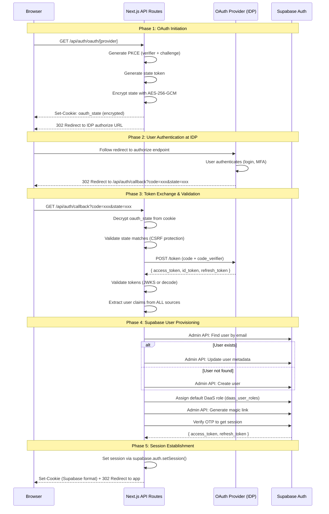

# Add External OAuth Provider

<!-- backend-gate:begin v1 -->
**Establish the backend first.** A Buildpad project's backend is either the Buildpad Engine or
Supabase, and some parts of this file hold for one of them only. Before you act on anything in
this file, find the backend with these steps, in order, and stop at the first step that answers:

1. Read `.buildpad/project.json` at the project root. If it is JSON and its field `backend` is
   `"engine"` or `"supabase"`, that is the backend. If `.buildpad/backend-answer.json` names the
   other backend, tell the developer the two files disagree, and follow `.buildpad/project.json`.
2. Otherwise read `.buildpad/backend-answer.json` in the same way; if its `backend` is
   `"engine"` or `"supabase"`, that is the backend.
3. If a folder named `supabase` at the project root holds a file named `config.toml`, or holds a
   folder named `migrations` that holds a file whose name ends in `.sql`, the backend is Supabase.
4. Otherwise ask the developer once: "Is this project's backend the Buildpad Engine or
   Supabase?" Write the answer to `.buildpad/backend-answer.json` as
   `{"buildpadBackendAnswer": 1, "backend": "engine"}` or
   `{"buildpadBackendAnswer": 1, "backend": "supabase"}`, and ask the developer to commit that
   file. Do not add it to `.gitignore`. Never write `.buildpad/project.json`.

To find the backend, do not open an environment file (`.env`, `.env.*`) or an MCP configuration
file, and do not call a tool that returns project credentials.

Then follow only the parts for that backend. A part starts at a line that holds only a comment
whose text is `buildpad` + `-backend: engine` or `buildpad` + `-backend: supabase`, and ends at the
next line that holds only a comment whose text is `/buildpad` + `-backend`. A comment that merely
mentions a backend is not a part. A file whose first line, after any front matter, holds only a
comment whose text is `buildpad` + `-backend-file: engine` (or `supabase`) holds for that backend
only, and so does every file in a folder named `engine-only` or `supabase-only`. Skip the other
backend's parts and copy no code from them; everything else holds for both. On an Engine project, when this file says that
something is not available, tell the developer so and stop: do not build a substitute.
<!-- backend-gate:end -->

<!-- buildpad-backend: engine -->
## On an Engine project: My Apps sign-in only

Of the external sign-ins, an Engine project offers only **My Apps sign-in**, and only while the
project's My Apps connector is connected. The application's server finishes the OpenID Connect
authorization-code flow with My Apps, then gives the ID token to the project's Engine through the
Supabase client's `signInWithIdToken`. The Engine checks the token and answers with an ordinary
session. Sign-in with any other provider (Azure AD, Google, Okta, Auth0 or another OIDC provider)
is not available on an Engine project: tell the developer so and stop.

On an Engine project these are not available, and My Apps sign-in uses none of them: a service-role
key, the Supabase administration API, a session made from a magic link or a one-time code, and a
role assignment that the application writes. The Platform's password-less handoff is for opening
the Studio and is not a way for an application to sign a user in.

### Step 1: Check the My Apps connector

1. Call the `get_project_detail` MCP tool.
2. Find the `my-apps` entry in `connectors`. My Apps sign-in is available only when its status is
   `connected` and it lists `externalSignIn` and its `OAUTH_*` variables. Then the Platform has
   registered the application's OIDC client with My Apps, for the deployed app's
   `/api/auth/callback` and for `http://localhost:3000/api/auth/callback`, and has told the Engine
   to trust that client.
3. If there is no such connector, tell the developer to connect My Apps on the project's Connectors
   page and stop. The application cannot register the client or make the Engine trust it.

### Step 2: Set the environment

From the connector, take `OAUTH_CLIENT_ID`, `OAUTH_CLIENT_SECRET`, `OAUTH_AUTHORIZATION_URL`,
`OAUTH_TOKEN_URL`, `OAUTH_USERINFO_URL`, `OAUTH_JWKS_URI` and `OAUTH_ISSUER`. Write them into
`.env.local` for local development. If the deployed app does not have them, set them with the
`amplify-env-vars` skill and redeploy.

On an Engine project the environment is: `NEXT_PUBLIC_SUPABASE_URL=<Engine_URL>`, `NEXT_PUBLIC_BUILDPAD_DAAS_URL=<Engine_URL>`, `NEXT_PUBLIC_SUPABASE_ANON_KEY=buildpad-engine-public-anon-key` (a fixed value that is not a secret; the Engine does not read it, the Supabase client needs one), and `NEXT_PUBLIC_BUILDPAD_TENANT_ID=<the project's tenant id>`. There is no service-role key on an Engine project: add none.

Keep `OAUTH_CLIENT_SECRET` on the application's server only, in a variable whose name does not
begin `NEXT_PUBLIC_`, and never send it to the Engine. My Apps sign-in needs no state secret and no
default role variable.

### Step 3: Install the files with the Buildpad CLI

```bash
npx @buildpad/cli@latest add external-oauth --cwd /path/to/project
```

The CLI reads `.buildpad/project.json`. On an Engine project it installs the module
`external-oauth-engine` in place of `external-oauth`, and `bootstrap` does the same. Check that
`buildpad.json` lists `external-oauth-engine` in `installedLib`. If it lists `external-oauth`
instead, the CLI is older than the Engine variant: do not use its OAuth routes, update the CLI and
run the command again. The module writes:

| File | What it does |
|---|---|
| `lib/oauth/engine.ts` | The flow cookie, the nonce digest, the Engine sign-in client, the role check and the error codes |
| `app/api/auth/oauth/[provider]/route.ts` | `GET /api/auth/oauth/my-apps`: starts the flow and redirects to My Apps |
| `app/api/auth/callback/route.ts` | Exchanges the code, signs in to the Engine, sets the session cookies |
| `components/auth/OAuthLoginButtons.tsx` | The "Continue with My Apps" button, and the message for each error code |
| `app/[lang]/auth/pending-access/page.tsx` | The page for an account that has no role yet |
| `lib/oauth/config.ts`, `pkce.ts`, `validate.ts`, `index.ts` | The shared OAuth helpers; the routes use the generic `OAUTH_*` configuration |

The CLI replaces the copies of these files that an earlier `external-oauth` install wrote, if they
are unchanged. It keeps a changed copy and warns: then compare it with the Engine version, or run
the command again with `--overwrite`.

Other skills say that the CLI's OAuth callback and provider routes cannot be used on an Engine
project. Those are the files of the `external-oauth` module. The files of `external-oauth-engine`
are the ones this part describes.

### Step 4: Add the button to the login page

In `app/[lang]/login/page.tsx`, import `OAuthLoginButtons` from
`@/components/auth/OAuthLoginButtons` and render `<OAuthLoginButtons showDivider />` below the
password form, inside a React `Suspense` boundary (the component reads the page's search
parameters). Keep the password form: administrators and existing password users sign in with it.

### How the sign-in works

1. `GET /api/auth/oauth/my-apps` makes a random `state`, a random raw nonce and a PKCE verifier. It
   keeps them in one httpOnly, `SameSite=Lax` cookie for ten minutes, and redirects to
   `OAUTH_AUTHORIZATION_URL` with `nonce` set to the lower-case hex SHA-256 digest of the raw nonce
   and `code_challenge` set to the S256 challenge of the verifier.
2. My Apps redirects to `/api/auth/callback?code=…&state=…`. The callback reads the cookie and
   compares `state`.
3. The callback exchanges the code at `OAUTH_TOKEN_URL` from the server, with `OAUTH_CLIENT_SECRET`
   and the PKCE verifier, and takes the `id_token` from the answer.
4. It calls `signInWithIdToken({ provider: 'my-apps', token: id_token, nonce: rawNonce })` on a
   Supabase server client for the Engine_URL that sends `X-Tenant-Id` with the value of
   `NEXT_PUBLIC_BUILDPAD_TENANT_ID`. `nonce` is the raw nonce: the Engine refuses a token whose
   nonce claim is not the SHA-256 digest of it. The provider name `my-apps` is fixed: it is the
   name the Engine knows My Apps by.
5. It asks `GET <Engine_URL>/api/users/me` with the new access token whether the account holds a
   role (see "Accounts and roles" below).
6. It sets the session cookies that the Supabase client wrote, in the format `lib/supabase/server.ts`
   and the middleware read, and redirects to the `returnTo` path. Every answer of the callback
   clears the flow cookie.

The core of the callback, for a project that cannot run the CLI:

```typescript
// app/api/auth/callback/route.ts (core of the Engine version)
import { type NextRequest, NextResponse } from "next/server";
import { createServerClient } from "@supabase/ssr";

type CookieToSet = { name: string; value: string; options?: Record<string, unknown> };

// After the state check and the code exchange, with `idToken` from My Apps and
// `rawNonce` from the flow cookie:
async function signInToEngine(request: NextRequest, idToken: string, rawNonce: string, returnTo: string) {
  const engineUrl = process.env.NEXT_PUBLIC_SUPABASE_URL!; // the Engine_URL
  const sessionCookies: CookieToSet[] = [];
  const supabase = createServerClient(engineUrl, process.env.NEXT_PUBLIC_SUPABASE_ANON_KEY!, {
    global: { headers: { "X-Tenant-Id": process.env.NEXT_PUBLIC_BUILDPAD_TENANT_ID! } },
    cookies: {
      getAll: () => request.cookies.getAll(),
      setAll: (list: CookieToSet[]) => { sessionCookies.push(...list); },
    },
  });

  const { data, error } = await supabase.auth.signInWithIdToken({
    provider: "my-apps",
    token: idToken,
    nonce: rawNonce, // My Apps received its SHA-256 hex digest
  });
  if (error || !data.session) {
    // Log the status and code only, never a token.
    const code = error?.code === "invalid_credentials" ? "sign_in_refused"
      : error?.code === "user_banned" ? "account_disabled"
      : (error?.status ?? 0) >= 500 ? "engine_unavailable" : "sign_in_failed";
    return NextResponse.redirect(new URL(`/login?error=${code}`, request.nextUrl.origin));
  }

  const me = await fetch(`${engineUrl}/api/users/me`, {
    headers: { Authorization: `Bearer ${data.session.access_token}` },
  }).then((r) => (r.ok ? r.json() : null)).catch(() => null);
  if (me?.data && me.data.roles?.length === 0 && !me.data.admin_access) {
    await supabase.auth.signOut(); // no cookie reaches the browser
    return NextResponse.redirect(new URL("/auth/pending-access", request.nextUrl.origin));
  }

  const response = NextResponse.redirect(new URL(returnTo, request.nextUrl.origin));
  for (const { name, value, options } of sessionCookies) response.cookies.set(name, value, options);
  return response;
}
```

Build the redirects from the app's public origin, as the CLI's `lib/origin.ts` does, and accept
only a relative `returnTo` path.

### Accounts and roles

- A user's first sign-in creates an account in the project's tenant that holds **no role**. The
  account can sign in but reads only what the project grants every caller, until an administrator
  gives it a role in the Studio (see the [`add-users`](../add-users/SKILL.md) skill). The application
  writes no role. The callback therefore ends a role-less session and shows
  `/auth/pending-access`, which tells the user that their account waits for access and that they
  sign in again once they have it. Do not let a role-less session into pages that the Engine will
  refuse.
- The Engine refuses some accounts: an account that holds a host role or administers the tenant,
  and an account that already exists with the same email but is not linked to this My Apps
  identity. It also refuses a token it does not trust, or an email that My Apps does not mark as
  verified. It gives every refusal the same answer as a wrong password, on purpose, so the
  application cannot tell them apart. Show one message (`sign_in_refused`) that tells the user to
  sign in with their email and password if they have one.
- A disabled account is answered `user_banned` (`account_disabled`). An Engine that cannot reach
  what it needs answers 503 (`engine_unavailable`).
- Signing out through the Supabase client ends the Engine session. It does not end the user's
  session at My Apps.

### Security

- Never log the ID token, the access token, the Engine session, the client secret or a session
  cookie. Log a status and an error code only.
- Send My Apps the SHA-256 hex digest of the nonce and give the Engine the raw nonce. Compare
  `state` before the code exchange, and use PKCE (S256).
- Keep the flow cookie httpOnly and single-use. In production the CLI names it with the `__Host-`
  prefix, which needs `Secure` and `Path=/`.

### Troubleshooting

| Code in `/login?error=` | Cause |
|---|---|
| `sign_in_refused` for every user | The connector is not `connected` (the Engine does not trust the client id), or the `nonce` sent to My Apps is not the digest of the nonce given to the Engine |
| `sign_in_refused` for one user | One of the refused accounts above; that user signs in with their password |
| `sign_in_failed` | The code exchange failed (check `OAUTH_CLIENT_SECRET` and that the redirect URI is registered), or the project's Engine has no My Apps sign-in enabled: ask the Buildpad Platform administrator |
| `sign_in_expired` | The flow cookie is missing: more than ten minutes passed, or the sign-in started in another browser or on another host name |
| `configuration_error` | An `OAUTH_*` variable or one of the Engine variables of Step 2 is missing |
<!-- /buildpad-backend -->
<!-- buildpad-backend: supabase -->
Implements external OAuth2/OIDC identity provider integration where **Next.js acts as the OAuth client**. This is the **required approach** for Buildpad DaaS applications since Supabase is self-hosted and deployment configuration is not accessible.

## When to Use This Skill

Use this skill when:
- Adding SSO/OAuth login to a DaaS application
- Integrating with My Apps, Azure AD, Okta, Auth0, Google, or any OAuth2/OIDC provider
- Self-hosted Supabase without access to deployment configuration
- Need JIT (Just-In-Time) user provisioning from external IDP

> **Login = auth + role.** JIT provisioning alone is not enough in a DaaS
> app: a user without a role gets deny-all from the permission enforcer, so
> the integration is not done until Step 6 (default role assignment) is
> implemented and verified with a brand-new IDP account.

> **Naming note**: "My Apps" here refers to a separate OIDC identity
> provider — not a Microsoft product. Do not confuse it with Microsoft's
> "My Apps" portal (`myapplications.microsoft.com`, part of Entra ID/Azure
> AD app assignment). If asked to integrate "SSO via MyApps" or "the IDP
> from MyApps" with no mention of Azure/Entra ID/Microsoft, treat it as
> this My Apps IDP and go to **Step 0** below — do not default to Azure
> AD/Entra ID.

My Apps is the only IDP here with a fully automated registration path —
see **Step 0** below before doing any manual setup.

## Architecture Overview



## Design Decisions

### 1. Next.js as OAuth Client (Not Supabase Built-in)

**Rationale**: Self-hosted Supabase deployments don't expose IDP configuration. Next.js handles the full OAuth flow.

| Component | Role |
|-----------|------|
| Next.js API Routes | OAuth client, token exchange, user provisioning |
| External IDP | User authentication, identity assertion |
| Supabase Auth | User database, session management, JWT issuance |

### 2. PKCE Required

**Rationale**: Security best practice. Prevents authorization code interception attacks.

- Use S256 method (SHA-256 hash of code_verifier)
- 32-byte random code_verifier (43 chars base64url)
- code_challenge sent to IDP, code_verifier sent on token exchange

### 3. State Encryption with AES-256-GCM

**Rationale**: Prevent state tampering and store sensitive data (code_verifier) securely.

State payload contains:
- `state`: Random CSRF token
- `codeVerifier`: PKCE verifier (sensitive)
- `provider`: OAuth provider name
- `returnTo`: Post-login redirect URL
- `createdAt`: Timestamp for expiration check

### 4. Multi-Source Claim Extraction

**Critical Learning**: Different OAuth providers return user claims in different places:

| Provider | Primary Claim Source |
|----------|---------------------|
| Azure AD | id_token |
| Google | id_token |
| Okta | id_token or access_token |
| Auth0 | id_token |
| Custom IDPs | Often access_token or userinfo endpoint |

**Implementation**: Check ALL sources in order:
1. Decode access_token as JWT (if not opaque)
2. Validate id_token (if present)
3. Call userinfo endpoint (if configured)
4. Merge all claims, later sources override earlier

### 5. Session via supabase.auth.setSession()

**Critical Learning**: Manually setting `sb-access-token` cookies doesn't work. Supabase SSR client uses a specific cookie format.

**Solution**: Create a Supabase SSR client in the callback route and call `setSession()`:

```typescript
const supabase = createServerClient(url, anonKey, {
  cookies: {
    getAll: () => request.cookies.getAll(),
    setAll: (cookies) => cookies.forEach(c => response.cookies.set(c.name, c.value, c.options)),
  },
});
await supabase.auth.setSession({ access_token, refresh_token });
```

### 6. Email Claim Detection

**Critical Learning**: Providers use different claim names for email:

| Claim Name | Providers |
|------------|-----------|
| `email` | Standard OIDC, Google, Auth0 |
| `preferred_username` | Azure AD (UPN) |
| `upn` | Some enterprise IDPs |
| `mail` | LDAP-style providers |
| `login` | GitHub |
| `username` | Some custom IDPs |

**Implementation**: Check all variants in `normalizeUserClaims()`.

### 7. Default DaaS Role Assignment on JIT Provisioning (Required)

**Critical Learning**: `findOrCreateUser()` creates the Supabase **auth** user only. In a DaaS application, permissions are resolved from `daas_user_roles` → access → policies → permissions. A JIT-provisioned user with no role has no policies, and the permission enforcer resolves every request to deny-all — so the first SSO login "succeeds" at the IDP but the user cannot actually use (or even finish logging into) the app.

**Solution**: Default role assignment is part of this skill, not an optional extra. Two pieces:

1. **Setup time (you, the agent)**: resolve the default role's UUID with the DaaS MCP `roles` tool. If the app has no suitable non-admin role with policies attached, create one via `/create-rbac` first. Store the UUID in the `OAUTH_DEFAULT_ROLE_ID` env var.
2. **Runtime (callback flow)**: after `findOrCreateUser()`, assign the default role to users that have no role assignment yet — see **Step 6** below.

## Issues Encountered & Solutions

### Issue 1: "no_email_claim" Error

**Problem**: ID token didn't contain email claim.

**Root Cause**: Provider returned email in access_token (JWT) instead of id_token.

**Solution**: Decode access_token as JWT and merge claims from all sources:
```typescript
// Try access_token as JWT
const accessTokenClaims = decodeTokenUnsafe(tokens.access_token);
if (accessTokenClaims) {
  allClaims = { ...allClaims, ...accessTokenClaims };
}
```

### Issue 2: Login Loop After OAuth Success

**Problem**: User authenticated successfully (logs showed "User authenticated") but was redirected back to login page.

**Root Cause**: Manually set cookies (`sb-access-token`, `sb-refresh-token`) were not in the format Supabase SSR middleware expects.

**Solution**: Use `supabase.auth.setSession()` from @supabase/ssr client instead of manual cookie setting. The SSR client handles the correct cookie format internally.

### Issue 3: No getUserByEmail in Supabase Admin API

**Problem**: `supabase.auth.admin.getUserByEmail()` doesn't exist.

**Solution**: Paginate through `listUsers()` to find by email:
```typescript
while (!existingUser) {
  const { data } = await supabase.auth.admin.listUsers({ page, perPage: 1000 });
  const found = data?.users.find(u => u.email?.toLowerCase() === email.toLowerCase());
  if (found) existingUser = found;
  if (!data?.users || data.users.length < perPage) break;
  page++;
}
```

### Issue 4: SSO Login Succeeds but User Is Denied Everything

**Problem**: A first-time SSO user authenticated at the IDP and received a Supabase session, but the app rejected them afterwards — empty data, permission errors on every request, or an immediate bounce back to the login page.

**Root Cause**: JIT provisioning created the auth user but nothing assigned a DaaS role. No `daas_user_roles` row → no policies → the DaaS permission enforcer denies everything.

**Solution**: Assign the app's default role right after provisioning (see Step 6). Verify a given user's assignment with:

```sql
select role_id from daas_user_roles where user_id = '<auth-user-uuid>';
```

## Step 0: Check Connectors for an Existing IDP First

**Do this before Step 2/Step 3 below, regardless of whether you use the CLI or
manual path.** Buildpad's Connectors system can auto-provision an OIDC client
(e.g. for My Apps) before you're even asked to build this
feature — if that already happened, the credentials exist and you don't need
to ask the user for anything or register a redirect URI yourself.

1. Call the `get_project_detail` MCP tool.
2. Look at the `connectors` array in the response for a `status: "connected"`
   entry whose `envVarNames` includes `OAUTH_CLIENT_ID` — that's the signal a
   connector is IDP-shaped (as opposed to a plain API-key connector like
   Stripe), regardless of its `provider` name. Don't match on provider name or
   on how the user phrased their request — check the data.
3. If found, use its `envVars` directly — they're already the exact
   `OAUTH_*` values this skill needs (`OAUTH_CLIENT_ID`, `OAUTH_CLIENT_SECRET`,
   `OAUTH_AUTHORIZATION_URL`, `OAUTH_TOKEN_URL`, `OAUTH_USERINFO_URL`,
   `OAUTH_JWKS_URI`, `OAUTH_ISSUER`). Write them into `.env.local` for local
   dev, and call the `amplify_set_env_vars` + `amplify_redeploy` MCP tools to
   push them to the deployed app. **Skip Step 3** (redirect URI registration)
   entirely — the connector already registered the deployed app's
   `/api/auth/callback` URL with the IDP at provision time.

   > **Not covered by the connector**: `OAUTH_DEFAULT_ROLE_ID` (Step 6). The
   > connector only knows about the IDP; the default role lives in this app's
   > DaaS backend. Resolve it via the DaaS MCP `roles` tool yourself and push
   > it alongside the connector env vars — SSO logins fail without it.
4. If no such connector is `connected` yet, tell the user they may be able to
   enable one from the project's Connectors settings page (auto-provision,
   one click — e.g. for My Apps) instead of manually registering with an
   IDP — then fall back to the fully manual Steps 2–3 below only if they want
   to proceed without it, or are integrating a provider with no Connectors
   auto-provision option (Azure/Google/Okta/Auth0/other).

## CLI Installation (Recommended)

The entire OAuth implementation is registered as the `external-oauth` lib module in the **microbuild-ui** CLI registry. Install it with one command:

```bash
# Install the external-oauth module (includes all files below)
pnpm cli add-lib external-oauth --cwd .

# Or during bootstrap:
pnpm cli bootstrap --cwd .
# Then install the oauth module separately since it's not included by default:
pnpm cli add-lib external-oauth --cwd .
```

This copies:
- `lib/oauth/config.ts` — provider configs (Azure, Google, Okta, Auth0, Generic)
- `lib/oauth/pkce.ts` — PKCE + AES-256-GCM state encryption
- `lib/oauth/validate.ts` — JWKS token validation + claim normalization
- `lib/oauth/index.ts` — barrel export
- `lib/supabase/admin.ts` — JIT user provisioning via Admin API
- `app/api/auth/oauth/[provider]/route.ts` — OAuth initiation route
- `app/api/auth/callback/route.ts` — Enhanced dual-mode callback (replaces basic version)
- `components/auth/OAuthLoginButtons.tsx` — Login button component

> **The CLI module does NOT include default role assignment.** After
> installing, you must still do **Step 6** (resolve `OAUTH_DEFAULT_ROLE_ID`,
> add `ensureDefaultRole()`, and call it from the callback) — otherwise
> JIT-provisioned users are denied everything on first login.

---

## Manual Implementation Steps

Use this when you cannot run the CLI and need to create files from scratch.

### Step 1: Install Dependencies

```bash
pnpm add jose
```

### Step 2: Add Environment Variables

Skip this if **Step 0** already found a connected My Apps connector — use its
`envVars` instead of the placeholder values below.

```env
# ═══════════════════════════════════════════════════════════════════════
# External OAuth Provider Configuration (Next.js as OAuth Client)
# ═══════════════════════════════════════════════════════════════════════

# Required: OAuth State Encryption Secret — generate with: openssl rand -base64 32
OAUTH_STATE_SECRET=your-32-byte-random-secret-here

# Required: default DaaS role assigned to JIT-provisioned SSO users (Step 6).
# Resolve the UUID via the DaaS MCP `roles` tool; create a role with
# /create-rbac if none exists. Never point this at an admin role.
OAUTH_DEFAULT_ROLE_ID=uuid-of-default-role

# Generic / Custom OIDC Provider
OAUTH_CLIENT_ID=your_client_id
OAUTH_CLIENT_SECRET=your_client_secret
OAUTH_AUTHORIZATION_URL=https://idp.example.com/connect/authorize
OAUTH_TOKEN_URL=https://idp.example.com/connect/token
OAUTH_USERINFO_URL=https://idp.example.com/connect/userinfo
OAUTH_JWKS_URI=https://idp.example.com/.well-known/jwks
OAUTH_ISSUER=https://idp.example.com
OAUTH_SCOPES=openid email profile
# Optional: JSON object of extra authorization params e.g. {"prompt":"select_account"}
# OAUTH_AUTH_PARAMS=

# Azure AD / Entra ID
# AZURE_AD_TENANT_ID=your-tenant-id
# AZURE_AD_CLIENT_ID=your_client_id
# AZURE_AD_CLIENT_SECRET=your_client_secret

# Google
# GOOGLE_CLIENT_ID=your_client_id
# GOOGLE_CLIENT_SECRET=your_client_secret

# Okta
# OKTA_DOMAIN=dev-123456.okta.com
# OKTA_CLIENT_ID=your_client_id
# OKTA_CLIENT_SECRET=your_client_secret

# Auth0
# AUTH0_DOMAIN=myapp.auth0.com
# AUTH0_CLIENT_ID=your_client_id
# AUTH0_CLIENT_SECRET=your_client_secret
```

### Step 3: Register Redirect URI with IDP

Skip this for My Apps if **Step 0** found a connected connector — the
redirect URI was already registered automatically when the connector was
provisioned.

| Setting | Value |
|---------|-------|
| Redirect URI | `https://your-app.com/api/auth/callback` |
| Grant Type | Authorization Code |
| PKCE | Required (S256) |
| Scopes | `openid email profile` (add `User.Read` for Azure) |

### Step 4: Create OAuth Library Files

**File structure:**
```
lib/oauth/
├── index.ts          # Barrel export
├── config.ts         # Provider configurations (all providers)
├── pkce.ts           # PKCE (RFC 7636) + AES-256-GCM state encryption
└── validate.ts       # JWKS token validation + multi-provider claim normalization

lib/supabase/
└── admin.ts          # Admin client + findOrCreateUser + generateUserSession

app/api/auth/
├── oauth/[provider]/route.ts    # OAuth initiation (PKCE, state cookie, redirect)
└── callback/route.ts            # Dual-mode: external OAuth + Supabase fallback

components/auth/
└── OAuthLoginButtons.tsx        # Login button component ('use client')
```

#### `lib/oauth/config.ts`

Defines `OAuthProviderConfig` interface and per-provider factory functions. All IDP settings come from environment variables. `getProviderConfig(provider)` dispatches to the right factory. `validateProviderEnv(provider)` returns missing env vars.

Key providers: `generic`, `azure`, `google`, `okta`, `auth0`.

```typescript
export interface OAuthProviderConfig {
  clientId: string;
  clientSecret: string;
  authorizationUrl: string;
  tokenUrl: string;
  userInfoUrl?: string;
  jwksUri?: string;
  issuer?: string;
  scopes: string[];
  authParams?: Record<string, string>;
}

export type SupportedProvider = 'generic' | 'azure' | 'google' | 'okta' | 'auth0';

export function getProviderConfig(provider: string): OAuthProviderConfig { /* ... */ }
export function validateProviderEnv(provider: string): { valid: boolean; missing: string[] } { /* ... */ }
```

#### `lib/oauth/pkce.ts`

PKCE utilities (RFC 7636) + AES-256-GCM state encryption/decryption.

- `generateCodeVerifier()` — 32 random bytes as base64url
- `generateCodeChallenge(verifier)` — SHA-256 hash of verifier, base64url
- `generateState()` — 16 random bytes as hex (CSRF token)
- `encryptState(data)` — AES-256-GCM encrypt object to base64url string
- `decryptState<T>(encrypted)` — decrypt and JSON parse
- `createOAuthState(provider, returnTo)` — creates the full `OAuthStateData` object
- `isStateExpired(stateData)` — checks `createdAt` against 10-minute expiry

```typescript
export interface OAuthStateData {
  state: string;       // CSRF token
  codeVerifier: string; // PKCE verifier
  provider: string;
  returnTo: string;
  createdAt: number;   // ms since epoch
}
```

#### `lib/oauth/validate.ts`

Token validation and claim normalization.

- `validateIdToken(idToken, config)` — uses JWKS if configured, falls back to decode-only
- `decodeTokenUnsafe(token)` — decode JWT without verification (for access_token claim extraction)
- `normalizeUserClaims(claims)` — extracts `email`, `name`, `firstName`, `lastName`, `picture`, `providerId`

`normalizeUserClaims` checks all known email claim variants: `email`, `preferred_username`, `upn`, `mail`, `emailAddress`, `user_email`, `login`, `username`.

#### `lib/supabase/admin.ts`

Admin client singleton + JIT user provisioning.

- `createSupabaseAdmin()` — singleton using `SUPABASE_SERVICE_ROLE_KEY`
- `findOrCreateUser(options)` — paginates `listUsers()` to find by email (no `getUserByEmail` exists!), then creates/updates, generates session via magic link + OTP verification
- `generateUserSession(supabase, user)` — uses `admin.generateLink('magiclink')` + `verifyOtp()` to get real `access_token` / `refresh_token`
- `ensureDefaultRole(userId)` — assigns `OAUTH_DEFAULT_ROLE_ID` in `daas_user_roles` if the user has no role yet (Step 6 — required, or SSO users are denied everything)

```typescript
export async function findOrCreateUser(options: FindOrCreateUserOptions): Promise<UserSessionResult>
// Returns: { user, session: { access_token, refresh_token, ... }, isNewUser }
```

#### `app/api/auth/oauth/[provider]/route.ts`

```typescript
export async function GET(request, { params }) {
  // 1. Validate provider name
  // 2. Validate env vars via validateProviderEnv()
  // 3. createOAuthState() + generateCodeChallenge()
  // 4. encryptState() → set HttpOnly cookie 'oauth_state' (10 min)
  // 5. Build authUrl with PKCE params
  // 6. return NextResponse.redirect(authUrl)
}
```

#### `app/api/auth/callback/route.ts`

Dual-mode: detects `oauth_state` cookie to choose external vs. Supabase flow.

```typescript
export async function GET(request) {
  // External OAuth path (oauth_state cookie present):
  // 1. Decrypt + validate state (CSRF check + expiry)
  // 2. POST to tokenUrl: code + code_verifier → { access_token, id_token, refresh_token }
  // 3. Merge claims from: decodeTokenUnsafe(access_token) + validateIdToken(id_token) + userinfo endpoint
  // 4. normalizeUserClaims() → email, name, etc.
  // 5. findOrCreateUser() → Supabase user + session
  // 6. ensureDefaultRole(user.id) → REQUIRED: assign default DaaS role (Step 6);
  //    on failure redirect with ?error=role_assignment_failed — do not continue,
  //    the session would be deny-all anyway
  // 7. createServerClient() + supabase.auth.setSession() → sets cookies in correct format
  // 8. NextResponse.redirect(oauthState.returnTo)

  // Supabase native fallback (no cookie):
  // supabase.auth.exchangeCodeForSession(code)
}
```

**Critical**: use `supabase.auth.setSession()` from `@supabase/ssr` `createServerClient` — do NOT manually set `sb-access-token` cookies. The SSR client sets the correct format the middleware recognises.

#### `components/auth/OAuthLoginButtons.tsx`

```tsx
'use client';
// Reads ?error= from URL for error display
// Renders Button per provider, onClick → window.location.href = '/api/auth/oauth/[id]?returnTo=...'
// Hides 'generic' SSO button when specific providers (azure/google) are also shown
export function OAuthLoginButtons({ providers?, returnTo?, showDivider? }) {}
```

### Step 5: Add Login UI

```tsx
import { OAuthLoginButtons } from '@/components/auth/OAuthLoginButtons';

// In your login page:
<OAuthLoginButtons showDivider />

// Show only specific providers:
<OAuthLoginButtons providers={['azure', 'google']} returnTo="/dashboard" />
```

### Step 6: Assign a Default Role to JIT-Provisioned Users (Required)

**Do this for both the CLI and manual paths.** Without it, first-time SSO
users have no DaaS role → no policies → the permission enforcer denies every
request, and login effectively fails even though the IDP round trip succeeded.

#### 6a. Resolve the default role (setup time, via MCP)

1. List the app's roles with the DaaS MCP `roles` tool:

   ```json
   { "name": "roles", "arguments": { "action": "read" } }
   ```

2. Pick the role meant for regular signed-in users (e.g. "Member",
   "Authenticated", "User") — **never an admin role**. Confirm it has at
   least one policy attached (check with the `access` tool) that grants the
   collections the app needs; if the app has no such role yet, create the
   role + policy + permissions with `/create-rbac` first.
3. Set `OAUTH_DEFAULT_ROLE_ID=<role-uuid>` in `.env.local`, and push it to
   the deployed app with `amplify_set_env_vars` + `amplify_redeploy`
   (together with the other `OAUTH_*` vars).

#### 6b. Assign at runtime (in `lib/supabase/admin.ts`)

```typescript
/**
 * Assign the app's default DaaS role to a user that has no role yet.
 * Without a role the DaaS permission enforcer denies every request,
 * so JIT-provisioned SSO users cannot use the app.
 */
export async function ensureDefaultRole(userId: string): Promise<void> {
  const roleId = process.env.OAUTH_DEFAULT_ROLE_ID;
  if (!roleId) {
    throw new Error(
      'OAUTH_DEFAULT_ROLE_ID is not set — SSO users provisioned without a role cannot log in'
    );
  }

  const supabase = createSupabaseAdmin();

  // Idempotent: skip if the user already has any role assignment
  // (also covers users provisioned before this step existed).
  const { data: existing, error: readError } = await supabase
    .from('daas_user_roles')
    .select('role_id')
    .eq('user_id', userId)
    .limit(1)
    .maybeSingle();

  if (readError) {
    throw new Error(`Failed to check existing role assignments: ${readError.message}`);
  }
  if (existing) return;

  const { error: insertError } = await supabase
    .from('daas_user_roles')
    .insert({ user_id: userId, role_id: roleId });

  if (insertError) {
    throw new Error(`Failed to assign default role: ${insertError.message}`);
  }
}
```

Call it in the callback route for **every** external OAuth login (the
idempotency check makes repeat calls free), and treat failure as fatal:

```typescript
const { user, session, isNewUser } = await findOrCreateUser({ /* ... */ });

try {
  await ensureDefaultRole(user.id);
} catch (roleError) {
  console.error('Default role assignment failed:', roleError);
  return NextResponse.redirect(
    new URL('/login?error=role_assignment_failed', request.url)
  );
}
```

> **If the insert fails with a foreign-key violation on `daas_users`**: the
> auth-user → `daas_users` sync hasn't produced a profile row for this user
> yet. Insert one first (`{ id: userId, email, status: 'active' }`) with the
> admin client, then retry the role insert.

#### 6c. Verify

Log in with a brand-new IDP account, then check:

```sql
select role_id from daas_user_roles where user_id = '<new-auth-user-uuid>';
```

The row must exist and the user must be able to reach the app's main pages —
an authenticated session alone is not a passing test.

## Security Considerations

### 1. State Secret

Generate a cryptographically strong secret:
```bash
openssl rand -base64 32
```

### 2. Service Role Key Protection

`SUPABASE_SERVICE_ROLE_KEY` bypasses RLS. Only use in server-side API routes.

### 3. Token Validation

Always configure JWKS for cryptographic verification when available:
```env
OAUTH_JWKS_URI=https://idp.example.com/.well-known/jwks
OAUTH_ISSUER=https://idp.example.com
```

### 4. Cookie Security

Production cookies:
- `HttpOnly`: Prevents XSS access
- `Secure`: HTTPS only
- `SameSite=Lax`: CSRF protection

## Troubleshooting

### "no_email_claim"

**Causes**:
1. Email not in id_token (check access_token or userinfo)
2. Wrong scope requested (ensure `email` scope)
3. Provider uses non-standard claim name

**Debug**: Check terminal logs for "Merged claims" to see all available claims.

### "state_mismatch"

**Causes**:
1. Cookie blocked (third-party cookies disabled)
2. Multiple browser tabs initiated OAuth
3. State expired (>10 minutes)

### Login Loop

**Causes**:
1. Session cookies not set in correct format
2. Middleware not recognizing session

**Solution**: Ensure using `supabase.auth.setSession()` not manual cookie setting.

### "role_assignment_failed" / Authenticated but Denied Everything

**Causes**:
1. `OAUTH_DEFAULT_ROLE_ID` not set (locally or in the Amplify environment)
2. The env var points at a deleted role, or a role with no policies attached
3. `ensureDefaultRole()` never wired into the callback (e.g. CLI install
   without Step 6)
4. FK violation because no `daas_users` profile row exists yet (see Step 6b)

**Debug**: Query `daas_user_roles` for the user's UUID. No row → runtime
assignment is broken. Row present but still denied → the role's policies/
permissions are the problem, not this skill; fix with `/create-rbac`.

## References

- [OAuth 2.0 RFC 6749](https://datatracker.ietf.org/doc/html/rfc6749)
- [PKCE RFC 7636](https://datatracker.ietf.org/doc/html/rfc7636)
- [Supabase Admin API](https://supabase.com/docs/reference/javascript/admin-api)
- [Supabase SSR](https://supabase.com/docs/guides/auth/server-side/nextjs)
<!-- /buildpad-backend -->
